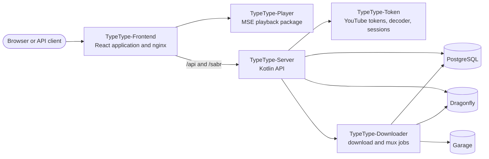

# Projektübersicht

TypeType ist eine Reihe unabhängig gebauter Dienste und Bibliotheken, die der zentrale
Bereitstellungs-Stack zusammenführt. Dieser Abschnitt richtet sich an Mitwirkende,
Integratoren und Betreiber, die verstehen müssen, welches Repository für ein Verhalten
zuständig ist und wie eine Anfrage durch das System läuft.

Wenn Sie nur eine Instanz installieren möchten, beginnen Sie mit der
[Einführung ins Selbsthosten](/de/self-hosting/introduction). Wenn Sie eine bestehende
Instanz nutzen, lesen Sie das [Benutzerhandbuch](/de/guide/).

## Systemübersicht {#system-map}

Der Browser spricht mit dem Web-Container. Dessen mitgelieferter nginx liefert die
React-Anwendung aus und leitet API-, WebSocket- und Wiedergabeverkehr an
TypeType-Server weiter. Server ist die Anwendungs- und API-Grenze hinter diesem
öffentlichen Web-Gateway; Token, Downloader, PostgreSQL, Dragonfly und Garage sind
interne Dienste.

## Öffentliche Repositorys {#public-repositories}

| Repository | Zuständig für |
| --- | --- |
| [TypeType](https://github.com/TypeType-Video/TypeType) | Compose-Stack, nginx, Installer, Aktualisierungen, Rollback, Koordination der Versionen und der zentrale Issue-Tracker |
| [TypeType-Frontend](https://github.com/TypeType-Video/TypeType-Frontend) | React-Routen, Oberfläche, Einstellungen, Kontoabläufe und Wiedergabesteuerung |
| [TypeType-Server](https://github.com/TypeType-Video/TypeType-Server) | HTTP-API, Extraktion, Konten, private Nutzerdaten, Wiedergabesitzungen und Integrationen |
| [TypeType-Token](https://github.com/TypeType-Video/TypeType-Token) | YouTube-PO-Token, Player-Dekodierung, SABR-Metadaten, Untertitel und Browser-Sitzungen für die Remote-Anmeldung |
| [TypeType-Downloader](https://github.com/TypeType-Video/TypeType-Downloader) | Dauerhafte Download-Aufträge, Medienübertragung, Muxen und Artefakte |
| [TypeType-Player](https://github.com/TypeType-Video/TypeType-Player) | Media-Source-Extensions-Kette des Browsers, die das Frontend verwendet |
| [TypeType-RPC](https://github.com/TypeType-Video/TypeType-RPC) | Desktop-Begleiter, der Ihre Wiedergabe als Discord-Rich-Presence-Status zeigt |
| [TypeType-Signals](https://github.com/TypeType-Video/TypeType-Signals) | Optionaler Empfehlungsdienst: die Startseiten-Algorithmen, die jeder Nutzer auswählt und einstellt |
| [Docs-TypeType](https://github.com/TypeType-Video/Docs-TypeType) | Dokumentation für Nutzer, Betreiber und das Projekt |
| [TypeType-Video/.github](https://github.com/TypeType-Video/.github) | Profil der Organisation und gemeinsame öffentliche Ressourcen |

Im [Repository-Leitfaden](./repositories) finden Sie die Einstiegspunkte in den
Quellcode, lokale Prüfungen, Lizenzen und wohin eine Änderung gehört.

## Wichtige Abläufe {#important-flows}

- [Wiedergabe und Downloads](./playback) erklärt SABR, das Player-Paket, Token und die
  Grenzen des Downloaders.
- [Branches und Versionen](./releases) erklärt `dev`, `main`, die Images der
  Komponenten, festgelegte Submodul-Stände und die Kanäle Beta und Stabil.
- [Signals, der Empfehlungsdienst](./signals) erklärt die optionalen
  Startseiten-Algorithmen und wie der Dienst zu Server passt.
- [Quellen aus der Community](./community) hält die Berichte und Diskussionen fest,
  die TypeType und diese Dokumentation verbessert haben.

## Maßgebliche Quellen {#sources-of-truth}

Halten Sie sich an diese Reihenfolge, wenn Dokumentation und Implementierung einander
zu widersprechen scheinen:

1. Der Quellcode und die Tests im Repository, das für das Verhalten zuständig ist.
2. Die aktuellen Compose- und Installer-Dateien des zentralen Stacks sowie die im
   Frontend mitgelieferte nginx-Konfiguration.
3. Die zentralen [Issues](https://github.com/TypeType-Video/TypeType/issues) und [Diskussionen](https://github.com/TypeType-Video/TypeType/discussions) für bekanntes
   Verhalten, Erfahrungen von Betreibern und Entscheidungen.
4. Diese Website für den unterstützten Ablauf.

Änderungen an der Dokumentation werden gegen alle drei vorgelagerten Quellen geprüft,
bevor sie als stabiles Verhalten dargestellt werden. Ein offenes Issue ist ein Hinweis
auf ein Problem, für sich genommen aber keine Spezifikation; maßgeblich für das
Verhalten der aktuellen Version bleibt der zuständige Quellcode.

## Quellen {#source-references}

- [Zentraler Compose-Stack](https://github.com/TypeType-Video/TypeType/blob/main/docker-compose.yml)
- [Mitgelieferte nginx-Konfiguration](https://github.com/TypeType-Video/TypeType-Frontend/blob/dev/nginx.conf)
- [Verdrahtung der Server-Anwendung](https://github.com/TypeType-Video/TypeType-Server/blob/dev/src/main/kotlin/dev/typetype/server/Application.kt)
- [Quellbaum des Frontends](https://github.com/TypeType-Video/TypeType-Frontend/tree/dev/apps/web/src)
