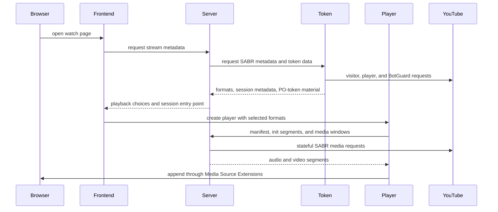
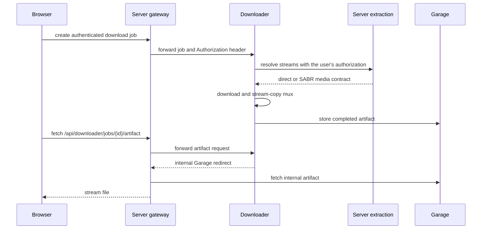

# Wiedergabe und Downloads

Die Wiedergabe berührt vier Repositorys: Frontend ist für die Bedienelemente
zuständig, Server für die Sitzung und den öffentlichen Medienvertrag, Token liefert
das YouTube-spezifische Sitzungsmaterial, und Player ist für die MSE-Kette im Browser
zuständig. Der Downloader verwendet den Vertrag von Server wieder, wenn ein Nutzer
eine Datei für die Offline-Nutzung anfordert.

## Weg der YouTube-Wiedergabe {#youtube-playback-path}



Der Browser erhält die SABR-URL des Anbieters nicht und spricht nicht mit Token.
Server behält die zustandsbehaftete Sitzung beim Anbieter, die Formatauswahl, die
Wiedergabeposition, zwischengespeicherte Segmente und die Generation für die
Wiederaufnahme. Player fordert nur Manifest- und Medienpfade an, die zu TypeType
gehören.

## Zuständigkeit je Schicht {#responsibility-by-layer}

### Frontend {#frontend}

Frontend entscheidet, was die Person verlangt hat: Qualität, Codec, Tonspur,
Untertitel, Nur-Audio-Modus, Position, automatische Wiedergabe und Anordnung des
Players. Es erzeugt und zerstört die Player-Engine und wandelt deren Ereignisse in
sichtbaren Zustand um.

### Server {#server}

Server stellt den Vertrag der Wiedergabesitzung unter `/sabr/playback/...` bereit. Er
wählt Formate aus, erzeugt ein isoliertes Sitzungstoken, lädt Initialisierungs- und
Mediendaten vor, verfolgt die Wiedergabeposition, behandelt Sprünge und Generationen
und entfernt untätige Sitzungen.

Bei Live-Inhalten folgen Server und Player einem gleitenden Wiedergabefenster statt
einer festen Liste von Segmenten. Ein Wechsel der Qualität oder der Tonspur erzeugt
einen Ersatzzustand der Wiedergabe an der angeforderten Position. Dieser Ersatzweg
existiert, aber [Issue #163](https://github.com/TypeType-Video/TypeType/issues/163) verfolgt einen aktuellen Fehler, bei dem die
Live-Wiedergabe nach einem Wechsel von Qualität oder Codec einfriert.

### Token {#token}

Token erzeugt das Material auf YouTube-Seite, das nötig ist, bevor Server eine Sitzung
aufbauen kann: Besucherdaten, PO-Token, Dekodierung der Player-URL, Metadaten der
adaptiven Formate und die SABR-Streaming-URL. Seine Antwort auf
`/youtube/sabr/session` ist intern und wird in Server-Modelle umgewandelt, bevor
irgendetwas den Browser erreicht.

Token ist für die aktuelle YouTube-Wiedergabe erforderlich, auch wenn die
Remote-Anmeldung bei YouTube abgeschaltet ist. Die optionale Einstellung steuert nur
den interaktiven Anmeldeablauf, nicht den Token- und Decoder-Dienst selbst.

### Player {#player}

`@typetype/mse` lädt das TypeType-Manifest, die Initialisierungsdaten und die
Segmentfenster. Es ist zuständig für die Operationen auf MediaSource und SourceBuffer,
den Abbruch von Anfragen, die Grenzen des Vorwärts- und Rückwärtspuffers, die Planung
der Segmente, Sprung-Generationen, Qualitätswechsel, das Folgen der Live-Kante und die
Erholung von veralteten oder unterbrochenen Anfragen.

Das Paket enthält bewusst keine Bedienelemente und keinen Anwendungszustand. Diese
Grenze erlaubt es, das Wiedergabeverhalten ohne die React-Oberfläche zu testen.

## Andere Mediendienste {#other-media-services}

Server kapselt außerdem PipePipeExtractor für unterstützte Dienste außer YouTube. Je
nach extrahierter Antwort kann Frontend direkte Medien, DASH, HLS oder einen
TypeType-Proxy verwenden. Die anbieterspezifische Extraktion bleibt in Server; der
SABR-Sitzungsvertrag von TypeType in Player ist gezielt die Browser-Kette für die
zustandsbehaftete TypeType-Wiedergabe.

## Weg eines Downloads {#download-path}



Die öffentliche Route ist `/api/downloader/...`; der Downloader-Dienst selbst bleibt
intern. Sein Auftrag behält den `Authorization`-Header des Nutzers, damit seine
spätere Extraktionsanfrage denselben Zugriff hat wie die ursprüngliche Anfrage des
Browsers.

Im mitgelieferten Stack erzeugt der Downloader eine interne Garage-URL. Server erkennt
den Host `garage` und reicht das Artefakt weiter, statt diesen privaten Hostnamen an
den Browser zu schicken. Eine normale Installation muss Garage daher nicht freigeben
und keinen S3-Endpunkt für den Browser setzen.

## Eine bereitgestellte Version untersuchen {#diagnosing-a-deployed-version}

Der mitgelieferte nginx gibt die Revision jedes Anwendungs-Images aus:

```sh
curl -fsS https://watch.example.com/api/version
curl -fsS https://watch.example.com/api/version/web
curl -fsS https://watch.example.com/api/version/server
curl -fsS https://watch.example.com/api/version/token
curl -fsS https://watch.example.com/api/version/downloader
```

Fügen Sie diese fünf Antworten bei, wenn ein Bericht zu Wiedergabe oder Download von
einer kürzlichen Änderung an einer Komponente abhängen kann. Geben Sie auch an, ob die
Instanz [main oder beta](/de/self-hosting/beta-and-main) folgt.

## Berichte, die in diese Seite eingeflossen sind {#reports-that-informed-this-page}

Die heutige Trennung zwischen Wiedergabe, Token und den Container-Grenzen wurde durch
[hugoghx’ Untersuchung der Token-Bereitstellung](https://github.com/TypeType-Video/TypeType/discussions/156) klarer. Berichte zu
Livestreams wie [Issue #145](https://github.com/TypeType-Video/TypeType/issues/145) und [Issue #163](https://github.com/TypeType-Video/TypeType/issues/163) haben außerdem geholfen,
die Begriffe Live-Sitzung und Qualitätswechsel zu erkennen, die hier ausdrücklich
genannt werden müssen. Alle Danksagungen stehen unter
[Quellen aus der Community](./community).

## Quellen {#source-references}

- [SABR-Routen von Server](https://github.com/TypeType-Video/TypeType-Server/blob/dev/src/main/kotlin/dev/typetype/server/routes/SabrRoutes.kt)
- [Sitzungsspeicher von Server](https://github.com/TypeType-Video/TypeType-Server/blob/dev/src/main/kotlin/dev/typetype/server/services/SabrSessionStore.kt)
- [SABR-Client von Server zu Token](https://github.com/TypeType-Video/TypeType-Server/blob/dev/src/main/kotlin/dev/typetype/server/services/TypetypeTokenYoutubeSessionClient.kt)
- [Implementierung der SABR-Sitzung in Token](https://github.com/TypeType-Video/TypeType-Token/blob/dev/src/youtube-sabr-session.ts)
- [Quellcode von Player](https://github.com/TypeType-Video/TypeType-Player/tree/dev/src)
- [Downloader-Gateway in Server](https://github.com/TypeType-Video/TypeType-Server/blob/dev/src/main/kotlin/dev/typetype/server/routes/DownloaderGatewayRoutes.kt)
- [Verarbeitungskette des Downloaders](https://github.com/TypeType-Video/TypeType-Downloader/tree/dev/internal/pipeline)
