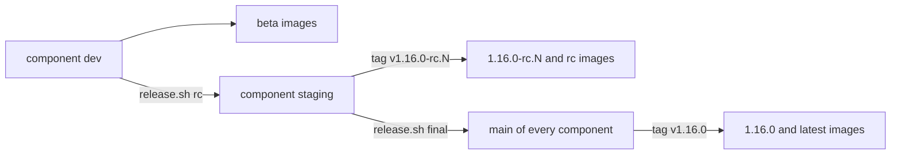

# Branches und Versionen

Die Komponenten von TypeType werden unabhängig entwickelt und dann vom zentralen Stack
zusammengesetzt. Wer zwischen einem Quell-Branch, einem Komponenten-Image und einer
laufenden Installation unterscheidet, vermeidet die meisten Verwechslungen bei
Versionen.

## Eine Version für den ganzen Stack {#one-version-for-the-whole-stack}

Seit TypeType 1.15.0 erscheint jede Komponente mit der TypeType-Version. TypeType
1.16.0 bedeutet Web 1.16.0, Server 1.16.0, Token 1.16.0 und Downloader 1.16.0, auch
wenn sich eine Komponente nicht geändert hat. Eine einzige Nummer sagt also, was eine
Instanz ausführt.

## Entwicklungs-, Staging- und stabile Linie {#development-staging-and-stable-lines}

| Linie | Branch | Image-Tags | Zweck |
| --- | --- | --- | --- |
| Entwicklung | `dev` | `typetype-beta:latest`, `typetype-beta:1.15.0-beta.N`, ... | Integration und Beta-Bereitstellung, kann kaputtgehen |
| Staging | `staging` | `typetype:1.16.0-rc.N`, `typetype:rc`, ... | Release-Kandidaten der nächsten Version |
| Stabil | `main` | `typetype:1.16.0`, `typetype:latest`, ... | Veröffentlichter Stack zum Selbsthosten |

Dieselben Tags gibt es für `typetype-server`, `typetype-token` und
`typetype-downloader`, alle unter `ghcr.io/typetype-video/`. Ein Beta-Image trägt die
Nummer der letzten Version und seine Build-Nummer: `1.15.0-beta.N` ist ein Build nach
1.15.0.

Pull Requests für Code zielen auf `dev`. Das zentrale TypeType-Repository verwendet
`main` als Standard, weil es auch der Einstiegspunkt für Installation und Versionen ist.

## So entsteht eine Version {#how-a-release-is-made}



1. Die Arbeit landet auf `dev`. Jeder Push baut die Beta-Images.
2. Ist eine Komponente bereit, setzt `scripts/release.sh rc 1.16.0 web` im zentralen
   Repository den `staging`-Branch dieser Komponente auf `dev` und setzt den nächsten
   Tag `v1.16.0-rc.N`. Der Tag baut das Image `1.16.0-rc.N` und verschiebt `rc`. Jede
   Komponente bekommt ihre eigenen Release-Kandidaten, so viele wie nötig.
3. Funktionieren die Release-Kandidaten zusammen, setzt `scripts/release.sh final
   1.16.0` `main` auf `staging` und setzt in allen Komponenten gleichzeitig den Tag
   `v1.16.0`. Die Tags bauen die Images `1.16.0` und verschieben `latest`.
4. Das zentrale Repository veröffentlicht die Versionshinweise und seinen eigenen Tag
   `v1.16.0`.

Images entstehen nur aus diesen Tags: Ein Push auf `main` baut nichts, und die Version
wird aus dem Tag gelesen, nicht aus einer Datei. `scripts/release.sh status 1.16.0`
zeigt, wo jede Komponente steht.

`latest` bewegt sich nur am Tag einer Version, ein Pull liefert also immer Images, die
zusammen veröffentlicht wurden. Es bleibt trotzdem ein beweglicher Tag: Legen Sie eine
Version mit `TYPETYPE_VERSION` fest, wie unter
[Wartung](/de/self-hosting/maintenance#pin-a-release) beschrieben, oder halten Sie vor
einer Aktualisierung die Image-Digests fest, wie unter
[Eine Aktualisierung zurücknehmen](/de/self-hosting/rollback) beschrieben.

## Zentrale Submodule {#central-submodules}

Das zentrale Repository enthält außerdem Git-Submodule für Frontend, Server, Player,
Token, Downloader und Docs. Ein zentraler Commit legt für jede Komponente genau eine
Quellrevision fest, während `.gitmodules` `dev` als den Branch nennt, dem während der
aktiven Entwicklung gefolgt wird.

Der Submodul-Baum ist nützlich, um Quellcode abzustimmen und zu prüfen. Die Herkunft
zur Laufzeit muss trotzdem am tatsächlichen Container-Digest oder an den Endpunkten
`/api/version/*` geprüft werden, weil die Compose-Standardwerte Kanal-Images auswählen,
statt alle Submodule lokal zu bauen.

## Prüfen, was läuft {#check-what-is-running}

Von außerhalb der Instanz:

```sh
curl -fsS https://watch.example.com/api/version
curl -fsS https://watch.example.com/api/version/web
curl -fsS https://watch.example.com/api/version/server
curl -fsS https://watch.example.com/api/version/token
curl -fsS https://watch.example.com/api/version/downloader
```

Vom Host aus:

```sh
docker compose images
docker image inspect "$(docker compose images -q typetype-server)" \
  --format '{{index .RepoDigests 0}}'
```

Die HTTP-Antworten nennen Quellrevisionen und Build-Zeiten. Die Docker-Inspektion
nennt den unveränderlichen Image-Digest. Bewahren Sie beides auf, wenn Sie ein
versionsspezifisches Verhalten dokumentieren oder melden.

## Installationen von main und beta {#main-and-beta-deployments}

Der stabile und der Beta-Stack können mit getrennten Compose-Projektnamen und Ports
nebeneinander laufen. Man darf nicht annehmen, dass sie dieselben Revisionen der
Komponenten ausführen: Die Beta rückt vor, sobald das `dev`-Image einer Komponente
angenommen wird, die stabile Version über den Versionsablauf.

Befehle und Hinweise zur Trennung finden Sie unter
[Beta und main](/de/self-hosting/beta-and-main).

## Quellen {#source-references}

- [Zentrale Submodul-Konfiguration](https://github.com/TypeType-Video/TypeType/blob/main/.gitmodules)
- [Zentraler Workflow für Komponenten-Images](https://github.com/TypeType-Video/TypeType/blob/main/.github/workflows/component-image.yml)
- [Image-Auswahl im stabilen Compose](https://github.com/TypeType-Video/TypeType/blob/main/docker-compose.yml)
- [Image-Auswahl im Beta-Compose](https://github.com/TypeType-Video/TypeType/blob/main/docker-compose.dev.yml)
