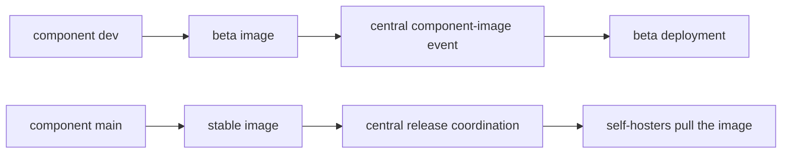

# Branches und Versionen

Die Komponenten von TypeType werden unabhängig entwickelt und dann vom zentralen Stack
zusammengesetzt. Wer zwischen einem Quell-Branch, einem Komponenten-Image und einer
laufenden Installation unterscheidet, vermeidet die meisten Verwechslungen bei
Versionen.

## Entwicklungs- und stabile Linie {#development-and-stable-lines}

| Linie | Branch | Muster der Container-Images | Zweck |
| --- | --- | --- | --- |
| Entwicklung | `dev` | `typetype-beta`, `typetype-server-beta`, `typetype-token-beta`, `typetype-downloader-beta` | Integration und Beta-Bereitstellung |
| Stabil | `main` | `typetype`, `typetype-server`, `typetype-token`, `typetype-downloader` | Veröffentlichter Stack zum Selbsthosten |

Alle obigen Image-Namen liegen unter `ghcr.io/typetype-video/` und verwenden den Tag
`:latest`, sofern kein abweichender Wert einen anderen Tag oder Digest auswählt.

Die meisten Komponenten-Repositorys verwenden `dev` als Standard-Branch. Pull Requests
für Code zielen auf `dev`; eine Versionsübernahme bringt die ausgewählte Arbeit nach
`main`. Das zentrale TypeType-Repository verwendet `main` als Standard, weil es auch
der Einstiegspunkt für Installation und Versionen ist.

`latest` ist ein beweglicher Container-Tag. Er bezeichnet das neueste Image dieses
Kanals, keine unveränderliche Version. Halten Sie vor einer Aktualisierung die
Image-Digests fest und verwenden Sie diese für ein Rollback, wie unter
[Eine Aktualisierung zurücknehmen](/de/self-hosting/rollback) beschrieben.

## Weg der Komponenten-Images {#component-image-flow}



Die Workflows der Komponenten bauen und veröffentlichen ihre eigenen Images. Danach
benachrichtigen sie das zentrale Repository mit dem Namen der Komponente, dem Kanal,
dem Image-Digest, der Quellrevision und der Build-Version. Der zentrale Workflow
stellt die Beta automatisch bereit. Stabile Benachrichtigungen werden festgehalten;
eine stabile Installation, öffentlich oder selbst gehostet, aktualisiert sich über
ihren eigenen Versions- oder Installer-Ablauf.

## Zentrale Submodule {#central-submodules}

Das zentrale Repository enthält außerdem Git-Submodule für Frontend, Server, Player,
Token, Downloader und Docs. Ein zentraler Commit legt für jede Komponente genau eine
Quellrevision fest, während `.gitmodules` `dev` als den Branch nennt, dem während der
aktiven Entwicklung gefolgt wird.

Der Submodul-Baum ist nützlich, um Quellcode abzustimmen und zu prüfen. Die Herkunft
zur Laufzeit muss trotzdem am tatsächlichen Container-Digest oder an den Endpunkten
`/api/version/*` geprüft werden, weil die Compose-Standardwerte Kanal-Images auswählen,
statt alle Submodule lokal zu bauen.

## Prüfen, was läuft {#check-what-is-running}

Von außerhalb der Instanz:

```sh
curl -fsS https://watch.example.com/api/version
curl -fsS https://watch.example.com/api/version/web
curl -fsS https://watch.example.com/api/version/server
curl -fsS https://watch.example.com/api/version/token
curl -fsS https://watch.example.com/api/version/downloader
```

Vom Host aus:

```sh
docker compose images
docker image inspect "$(docker compose images -q typetype-server)" \
  --format '{{index .RepoDigests 0}}'
```

Die HTTP-Antworten nennen Quellrevisionen und Build-Zeiten. Die Docker-Inspektion
nennt den unveränderlichen Image-Digest. Bewahren Sie beides auf, wenn Sie ein
versionsspezifisches Verhalten dokumentieren oder melden.

## Installationen von main und beta {#main-and-beta-deployments}

Der stabile und der Beta-Stack können mit getrennten Compose-Projektnamen und Ports
nebeneinander laufen. Man darf nicht annehmen, dass sie dieselben Revisionen der
Komponenten ausführen: Die Beta rückt vor, sobald das `dev`-Image einer Komponente
angenommen wird, die stabile Version über den Versionsablauf.

Befehle und Hinweise zur Trennung finden Sie unter
[Beta und main](/de/self-hosting/beta-and-main).

## Quellen {#source-references}

- [Zentrale Submodul-Konfiguration](https://github.com/TypeType-Video/TypeType/blob/main/.gitmodules)
- [Zentraler Workflow für Komponenten-Images](https://github.com/TypeType-Video/TypeType/blob/main/.github/workflows/component-image.yml)
- [Image-Auswahl im stabilen Compose](https://github.com/TypeType-Video/TypeType/blob/main/docker-compose.yml)
- [Image-Auswahl im Beta-Compose](https://github.com/TypeType-Video/TypeType/blob/main/docker-compose.dev.yml)
