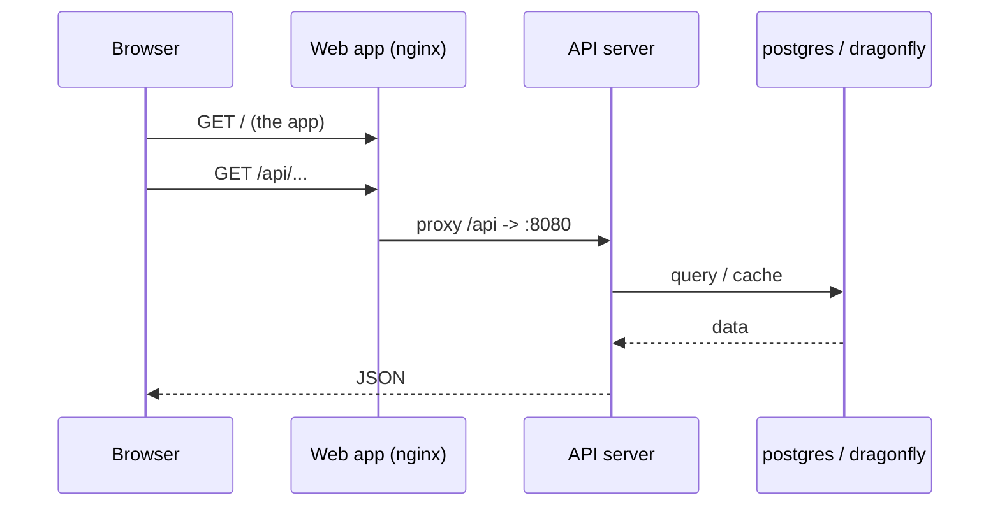
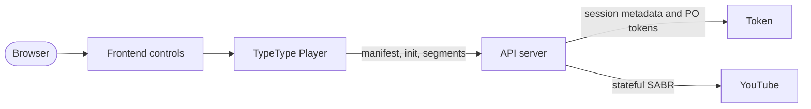
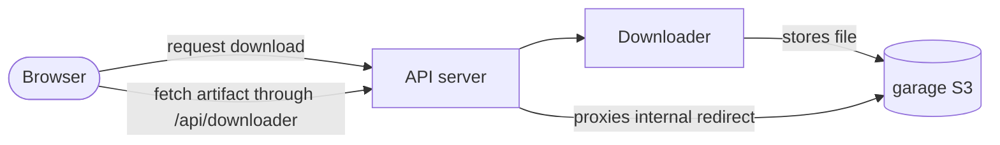

# Architektur

Diese Seite erklärt, wie die Dienste miteinander sprechen und wo Ihre Daten liegen.
Zum Installieren von TypeType brauchen Sie sie nicht, aber sie macht Betrieb und
Fehlersuche im Stack deutlich einfacher.

## Netzwerk {#networking}

Compose legt alle Dienste in ein privates Netzwerk und gibt jedem einen DNS-Namen, der
seinem Dienstnamen entspricht (`typetype-server`, `postgres`, `garage`, ...). Die
Dienste erreichen sich über diese Namen, nie über Host-Ports.

Nur wenige Ports werden auf dem Host **veröffentlicht**. Interne Diagnose-Ports sind
standardmäßig an die Loopback-Schnittstelle gebunden:

| Veröffentlicht | Dienst | Wer ihn braucht |
| --- | --- | --- |
| `HOST_PORT_WEB` (8082) | Web-App | Ihre Nutzer (hier setzt der Reverse-Proxy an) |
| `HOST_BIND_SERVER:HOST_PORT_SERVER` (`127.0.0.1:8080`) | API-Server | optionale Zustandsprüfung und direkter API-Zugriff vom Host aus |
| `HOST_BIND_TOKEN:HOST_PORT_TOKEN` (`127.0.0.1:8081`) | Token | optionale Zustandsdiagnose vom Host aus |
| `HOST_BIND_GARAGE_S3:HOST_PORT_GARAGE_S3` (`127.0.0.1:3900`) | Objektspeicher | Einrichtung und Diagnose |

Alles andere (`postgres`, `dragonfly`, der Downloader) bleibt intern. Nehmen Sie
Token, Downloader, PostgreSQL oder Dragonfly nicht in einen öffentlichen Reverse-Proxy
auf. Siehe [Sicherheitsgrenzen](./security).

## Weg einer Anfrage {#request-path}

Ein normaler Seitenaufruf:

Der Web-Container liefert die statische App aus und leitet alles unter `/api/` an den
Server weiter, einschließlich WebSocket-Upgrades. Er leitet auch die Wiedergabepfade
unter `/sabr/` weiter. Deshalb muss Ihr externer Reverse-Proxy immer nur auf den
Web-Container zeigen.

## Weg der Wiedergabe {#playback-path}

Token ist eine interne Abhängigkeit für YouTube-PO-Token, Player-Dekodierung,
SABR-Sitzungsmetadaten und Untertitel. Die Remote-Anmeldung ist optional, der
Token-Dienst selbst gehört aber zum normalen Stack. Server besitzt die Sitzung beim
Anbieter und gibt dem Browser Medienpfade, die zu TypeType gehören; der Browser ruft
Token nie direkt auf.

Den Ablauf auf Quellcode-Ebene finden Sie unter
[Wiedergabe und Downloads](/de/project/playback).

## Weg eines Downloads {#download-path}

Der Downloader schreibt die fertige Datei nach Garage. Der mitgelieferte Stack gibt
dem Downloader eine interne Garage-URL. Leitet der Artefakt-Endpunkt auf den internen
Host `garage` um, holt Server die Datei und streamt sie über das öffentliche Gateway
`/api/downloader/...`. Der Browser braucht also keinen direkten Zugriff auf Garage.

Eigene Installationen können einen wirklich öffentlichen S3-Endpunkt verwenden, das
ist aber eine Einstellung des Downloader-Dienstes und kein erforderlicher `.env`-Wert
im unterstützten Stack.

## Wo die Daten liegen {#where-data-lives}

Der Zustand liegt in benannten Docker-Volumes, `docker compose down` (ohne `-v`)
behält also alles:

| Volume | Inhalt |
| --- | --- |
| `postgres_data` | Konten, Verlauf, Wiedergabelisten, Einstellungen |
| `garage_meta`, `garage_data` | der Objektspeicher (Downloads) |
| `typetype_secrets` | die automatisch erzeugten Geheimnisse |

Sichern Sie diese, um eine Installation zu erhalten. Siehe
[Wartung](./maintenance#backups).

## Geheimnisse {#secrets}

Der Init-Container `typetype-secrets` erzeugt beim ersten Start zwei Geheimnisse im
Volume `typetype_secrets`. Server und Token lesen sie von dort. Werte, die Sie in
`.env` setzen, haben Vorrang, und Platzhaltertext (`SET_ME_...`) wird ignoriert; die
Platzhalter unverändert zu lassen ist also unbedenklich. Siehe
[Konfiguration](./configuration#secrets-handled-automatically).

Garage verwendet ein eigenes `GARAGE_RPC_SECRET` aus `.env`. Der Installer erzeugt es;
bei einer Einrichtung ohne Skripte müssen Sie es erzeugen, bevor Garage startet. Siehe
[Manuelle Einrichtung](./docker-compose#create-your-configuration).
