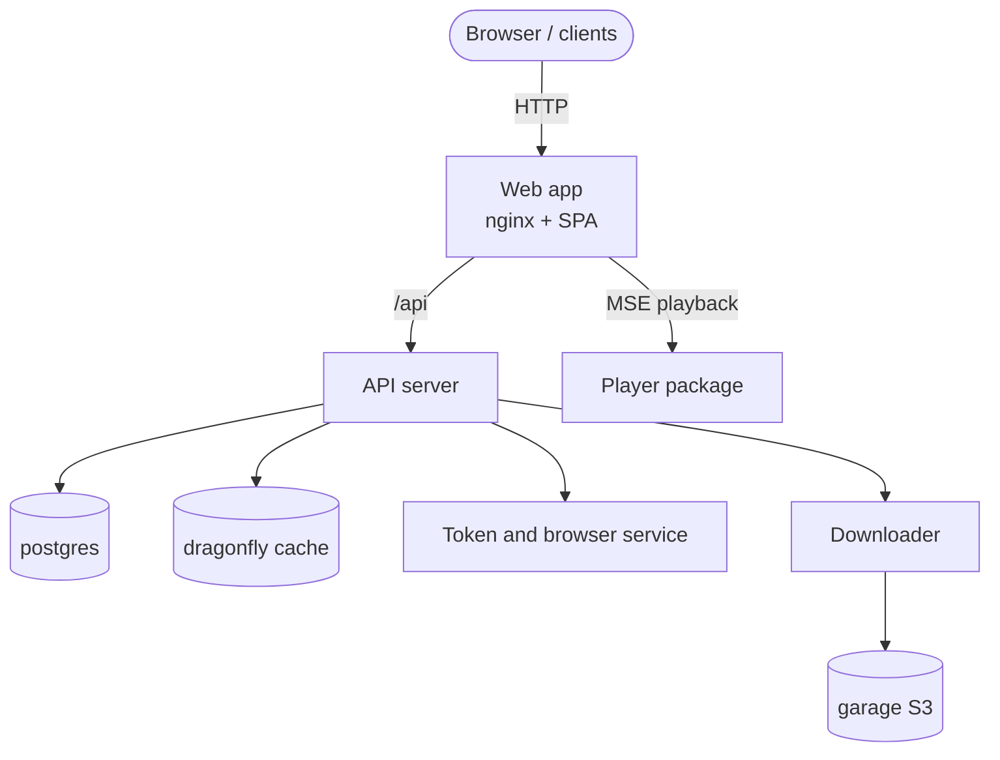

# Einführung

TypeType ist keine einzelne App, sondern ein **selbst hostbares Ökosystem**. Eine
Installation besteht aus mehreren zusammenarbeitenden Diensten: einer Web-App, einem
API-Server, einem Token- und Browser-Dienst, einem Downloader und den Datenspeichern,
auf die sie angewiesen sind. Zusammen betreiben Sie damit Ihre eigene Videoplattform
von Anfang bis Ende.

Diese Anleitung behandelt sowohl den unterstützten Installer als auch eine manuelle
Einrichtung mit Docker Compose. Der Installer legt die `.env` an, erzeugt Geheimnisse,
wählt freie Ports und richtet den Objektspeicher ein. Der manuelle Weg beschreibt
dieselbe Installation als einfache Befehle, damit Sie jeden Schritt prüfen und steuern
können.

## Die Komponenten {#the-components}

| Komponente | Repository / Image | Aufgabe |
| --- | --- | --- |
| Web-App | `ghcr.io/typetype-video/typetype` | Die Oberfläche, dazu ein nginx, der `/api` an den Server weiterleitet |
| API-Server | `ghcr.io/typetype-video/typetype-server` | Konten, Extraktion, die REST-API, der Kern des Ökosystems |
| Downloader | `ghcr.io/typetype-video/typetype-downloader` | Bereitet Downloads vor und legt sie im Objektspeicher ab |
| Token | `ghcr.io/typetype-video/typetype-token` | YouTube-PO-Token, Player-Dekodierung, SABR-Metadaten, Untertitel und optionale Remote-Anmeldung |
| Datenbank | `postgres` | Konten, Verlauf, Wiedergabelisten, Einstellungen |
| Cache | `dragonfly` | Redis-kompatibler Cache |
| Objektspeicher | `garage` | S3-kompatibler Speicher für Downloads |

Andere Clients können denselben API-Server nutzen, eine einzige selbst gehostete
Installation kann also mehr als die Web-App bedienen.

## Wie sie zusammenpassen {#how-they-fit-together}

Nur die **Web-App** muss für Ihre Nutzer erreichbar sein. Im Produktivbetrieb stellen
Sie einen Reverse-Proxy davor und liefern sie über HTTPS aus, wie in
[Reverse-Proxy und HTTPS](./reverse-proxy) beschrieben.

Token ist ein interner Dienst, für die aktuelle YouTube-Wiedergabe aber nicht
optional. `YOUTUBE_REMOTE_LOGIN_ENABLED` steuert nur die interaktive
YouTube-Anmeldung; PO-Token, Decoder, Untertitel und SABR laufen weiterhin über Token,
wenn die Remote-Anmeldung aus ist.

Welches Repository wofür zuständig ist und wie der Wiedergabepfad im Browser aussieht,
steht in der [Projektübersicht](/de/project/) und unter
[Wiedergabe und Downloads](/de/project/playback).

## Wie es aussieht {#what-it-looks-like}

Eine selbst gehostete Instanz im Betrieb, beim Abspielen eines Videos, beim Suchen,
und ihre Einstellungen:

---

---

---

Die Wiedergabe in Aktion:

## Wie diese Anleitung aufgebaut ist {#how-this-guide-is-organised}

1. [Architektur](./architecture): wie die Teile miteinander sprechen und wo die Daten
   liegen.
2. [Sicherheitsgrenzen](./security): was öffentlich, intern und browsergestützt ist.
3. [Voraussetzungen](./prerequisites): was Sie brauchen, bevor Sie beginnen.
4. [Schnellstart](./quick-start): die empfohlene Installation mit einem Befehl.
5. [Manuelle Einrichtung](./docker-compose): dasselbe von Hand, Schritt für Schritt.
6. [Konfiguration](./configuration): jede Umgebungsvariable, erklärt.
7. [Ihre Daten importieren](./importing-data): Abonnements, Wiedergabelisten und
   Verlauf mitbringen.
8. [Reverse-Proxy und HTTPS](./reverse-proxy): unter Ihrer Domain bereitstellen.
9. [Wartung](./maintenance): Aktualisierungen, Sicherungen und Protokolle.
10. [Beta und main](./beta-and-main): den stabilen und den Vorschaukanal betreiben.
11. [Probleme melden](./reporting-issues): wie Sie Fehler melden.
12. [Fehlerbehebung](./troubleshooting): häufige Probleme und Lösungen.

::: tip Woher kommen die Dateien?
Die `docker-compose.yml`, die `.env.example` und die Stack-Skripte, auf die diese
Anleitung verweist, liegen im TypeType-Repository. Das Web-Image enthält seine
nginx-Konfiguration, und Compose legt die Standardkonfiguration von Garage in einem
benannten Volume an. Klonen Sie zuerst das zentrale Repository (siehe
[Manuelle Einrichtung](./docker-compose) oder [Schnellstart](./quick-start)).
:::
