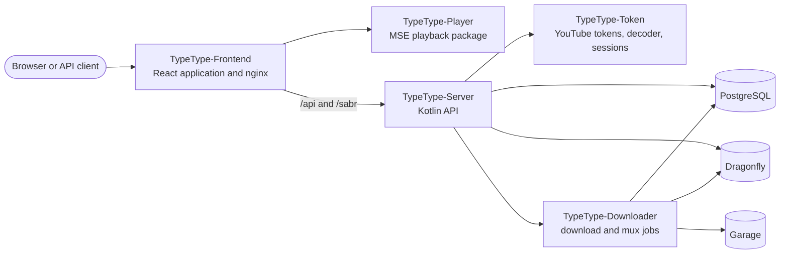

# Visión general del proyecto

TypeType es un conjunto de servicios y bibliotecas construidos de forma independiente
y unidos por la pila central de despliegue. Esta sección es para contribuidores,
integradores y operadores que necesitan entender qué repositorio es dueño de un
comportamiento y cómo recorre el sistema una petición.

Si solo quieres instalar una instancia, empieza por la
[introducción al autoalojamiento](/es/self-hosting/introduction). Si usas una
instancia existente, consulta la [guía del usuario](/es/guide/).

## Mapa del sistema {#system-map}

El navegador habla con el contenedor web. Su nginx incluido sirve la aplicación React
y reenvía el tráfico de API, WebSocket y reproducción a TypeType-Server. Server es el
límite de aplicación y API detrás de esa pasarela web pública; Token, Downloader,
PostgreSQL, Dragonfly y Garage son servicios internos.

## Repositorios públicos {#public-repositories}

| Repositorio | Es dueño de |
| --- | --- |
| [TypeType](https://github.com/TypeType-Video/TypeType) | Pila Compose, nginx, instalador, actualizaciones, reversión, coordinación de versiones y el gestor central de incidencias |
| [TypeType-Frontend](https://github.com/TypeType-Video/TypeType-Frontend) | Rutas de React, interfaz, ajustes, flujos de cuenta y controles de reproducción |
| [TypeType-Server](https://github.com/TypeType-Video/TypeType-Server) | API HTTP, extracción, cuentas, datos privados de los usuarios, sesiones de reproducción e integraciones |
| [TypeType-Token](https://github.com/TypeType-Video/TypeType-Token) | Tokens PO de YouTube, decodificación del reproductor, metadatos SABR, subtítulos y sesiones de navegador para el inicio de sesión remoto |
| [TypeType-Downloader](https://github.com/TypeType-Video/TypeType-Downloader) | Trabajos de descarga persistentes, transferencia de medios, multiplexado y artefactos |
| [TypeType-Player](https://github.com/TypeType-Video/TypeType-Player) | Cadena de Media Source Extensions del navegador que usa el frontend |
| [TypeType-RPC](https://github.com/TypeType-Video/TypeType-RPC) | Aplicación de escritorio que muestra tu reproducción como estado de Discord Rich Presence |
| [TypeType-Signals](https://github.com/TypeType-Video/TypeType-Signals) | Servicio de recomendaciones opcional: los algoritmos de la página de inicio que cada usuario elige y ajusta |
| [Docs-TypeType](https://github.com/TypeType-Video/Docs-TypeType) | Documentación para usuarios, operadores y del proyecto |
| [TypeType-Video/.github](https://github.com/TypeType-Video/.github) | Perfil de la organización y recursos públicos compartidos |

Lee la [Guía de repositorios](./repositories) para conocer los puntos de entrada del
código, las comprobaciones locales, las licencias y dónde corresponde un cambio.

## Flujos importantes {#important-flows}

- [Reproducción y descargas](./playback) explica SABR, el paquete Player, Token y los
  límites de Downloader.
- [Ramas y versiones](./releases) explica `dev`, `main`, las imágenes de los
  componentes, las fijaciones de submódulos y los canales beta y estable.
- [Signals, el servicio de recomendaciones](./signals) explica los algoritmos
  opcionales de la página de inicio y cómo encaja el servicio con Server.
- [Fuentes de la comunidad](./community) recoge los informes y discusiones que
  mejoraron tanto TypeType como esta documentación.

## Fuentes de verdad {#sources-of-truth}

Usa este orden cuando la documentación y la implementación parezcan contradecirse:

1. El código y las pruebas del repositorio dueño del comportamiento.
2. Los archivos actuales de Compose y del instalador de la pila central, más la
   configuración de nginx incluida en el frontend.
3. Las [incidencias](https://github.com/TypeType-Video/TypeType/issues) y las [discusiones](https://github.com/TypeType-Video/TypeType/discussions) centrales, para el
   comportamiento conocido, la experiencia de los operadores y las decisiones.
4. Este sitio, para el flujo de trabajo compatible.

Los cambios de la documentación se verifican contra las tres fuentes de origen antes
de presentarse como comportamiento estable. Una incidencia abierta es indicio de un
problema, no una especificación por sí misma; el código del repositorio dueño sigue
decidiendo qué hace la versión actual.

## Referencias {#source-references}

- [Pila Compose central](https://github.com/TypeType-Video/TypeType/blob/main/docker-compose.yml)
- [Configuración de nginx incluida](https://github.com/TypeType-Video/TypeType-Frontend/blob/dev/nginx.conf)
- [Conexión de la aplicación Server](https://github.com/TypeType-Video/TypeType-Server/blob/dev/src/main/kotlin/dev/typetype/server/Application.kt)
- [Árbol de código del Frontend](https://github.com/TypeType-Video/TypeType-Frontend/tree/dev/apps/web/src)
