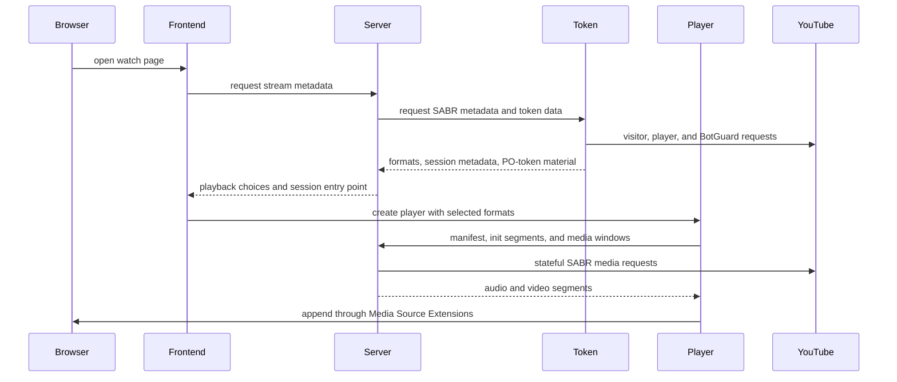
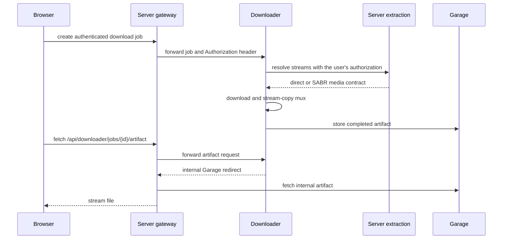

# Reproducción y descargas

La reproducción cruza cuatro repositorios: Frontend es dueño de los controles, Server
es dueño de la sesión y del contrato público de medios, Token aporta el material de
sesión específico de YouTube, y Player es dueño de la cadena MSE del navegador.
Downloader reutiliza el contrato de Server cuando un usuario pide un archivo sin
conexión.

## Recorrido de la reproducción de YouTube



El navegador no recibe la URL SABR de origen ni habla con Token. Server conserva la
sesión de origen con estado, la selección de formatos, la posición de reproducción,
los segmentos en caché y la generación de recuperación. Player solo pide rutas de
manifiesto y de medios propias de TypeType.

## Responsabilidad por capa

### Frontend

Frontend decide lo que pidió la persona: calidad, códec, pista de audio, subtítulos,
modo solo audio, posición, reproducción automática y disposición del reproductor. Crea
y destruye el motor de Player y convierte los eventos del motor en estado visible.

### Server

Server expone el contrato de sesión de reproducción bajo `/sabr/playback/...`.
Selecciona formatos, crea un token de sesión aislado, precarga los datos de
inicialización y de medios, sigue la posición de reproducción, gestiona los saltos y
las generaciones, y expulsa las sesiones inactivas.

Para el contenido en directo, Server y Player siguen una ventana de reproducción móvil
en lugar de una lista fija de segmentos. Un cambio de calidad o de pista de audio crea
un estado de reproducción de sustitución en la posición pedida. La ruta de sustitución
existe, pero la [incidencia #163](https://github.com/TypeType-Video/TypeType/issues/163) sigue un fallo actual en el que la
reproducción en directo se congela tras un cambio de calidad o de códec.

### Token

Token crea el material del lado de YouTube necesario antes de que Server pueda
construir una sesión: datos de visitante, tokens PO, decodificación de la URL del
reproductor, metadatos de formatos adaptativos y la URL de transmisión SABR. Su
respuesta `/youtube/sabr/session` es interna y se convierte en modelos de Server antes
de que nada llegue al navegador.

Token es necesario para la reproducción actual de YouTube incluso cuando el inicio de
sesión remoto en YouTube está desactivado. El ajuste opcional controla solo el flujo
de inicio de sesión interactivo, no el propio servicio de tokens y decodificación.

### Player

`@typetype/mse` carga el manifiesto de TypeType, los datos de inicialización y las
ventanas de segmentos. Es dueño de las operaciones de MediaSource y SourceBuffer, la
cancelación de peticiones, los límites del búfer hacia delante y hacia atrás, la
planificación de segmentos, las generaciones de salto, los cambios de calidad, el
seguimiento del borde del directo y la recuperación tras peticiones obsoletas o
interrumpidas.

El paquete no contiene deliberadamente controles ni estado de aplicación. Ese límite
permite probar el comportamiento de la reproducción sin la interfaz de React.

## Otros servicios de medios

Server también envuelve PipePipeExtractor para los servicios compatibles distintos de
YouTube. Según la respuesta extraída, Frontend puede usar medios directos, DASH, HLS o
un proxy de TypeType. La extracción específica de cada proveedor se queda en Server;
el contrato de sesión SABR de TypeType de Player es específicamente la cadena del
navegador para la reproducción de TypeType con estado.

## Recorrido de una descarga



La ruta pública es `/api/downloader/...`; el propio servicio Downloader sigue siendo
interno. Su trabajo conserva la cabecera `Authorization` del usuario para que su
petición de extracción posterior tenga el mismo acceso que la petición original del
navegador.

En la pila incluida, Downloader crea una URL interna de Garage. Server reconoce el
host `garage` y entrega el artefacto en lugar de enviar ese nombre de host privado al
navegador. Por tanto, un despliegue normal no necesita exponer Garage ni definir un
punto de acceso S3 de cara al navegador.

## Diagnosticar una versión desplegada

El nginx incluido expone la revisión de cada imagen de aplicación:

```sh
curl -fsS https://watch.example.com/api/version
curl -fsS https://watch.example.com/api/version/web
curl -fsS https://watch.example.com/api/version/server
curl -fsS https://watch.example.com/api/version/token
curl -fsS https://watch.example.com/api/version/downloader
```

Incluye estas cinco respuestas cuando un informe de reproducción o de descarga pueda
depender de un cambio reciente en un componente. Indica también si la instancia sigue
[main o beta](/es/self-hosting/beta-and-main).

## Informes que dieron forma a esta página

La separación actual entre la reproducción, Token y los límites de los contenedores
quedó más clara gracias a la
[investigación del despliegue de Token de hugoghx](https://github.com/TypeType-Video/TypeType/discussions/156). Informes sobre directos
como la [incidencia #145](https://github.com/TypeType-Video/TypeType/issues/145) y la [incidencia #163](https://github.com/TypeType-Video/TypeType/issues/163) también ayudaron a
identificar los conceptos de sesión en directo y cambio de calidad que deben quedar
explícitos aquí. Consulta [Fuentes de la comunidad](./community) para ver todos los
agradecimientos.

## Referencias

- [Rutas SABR de Server](https://github.com/TypeType-Video/TypeType-Server/blob/dev/src/main/kotlin/dev/typetype/server/routes/SabrRoutes.kt)
- [Almacén de sesiones de Server](https://github.com/TypeType-Video/TypeType-Server/blob/dev/src/main/kotlin/dev/typetype/server/services/SabrSessionStore.kt)
- [Cliente SABR de Server a Token](https://github.com/TypeType-Video/TypeType-Server/blob/dev/src/main/kotlin/dev/typetype/server/services/TypetypeTokenYoutubeSessionClient.kt)
- [Implementación de la sesión SABR de Token](https://github.com/TypeType-Video/TypeType-Token/blob/dev/src/youtube-sabr-session.ts)
- [Código de Player](https://github.com/TypeType-Video/TypeType-Player/tree/dev/src)
- [Pasarela de Downloader en Server](https://github.com/TypeType-Video/TypeType-Server/blob/dev/src/main/kotlin/dev/typetype/server/routes/DownloaderGatewayRoutes.kt)
- [Cadena de procesamiento de Downloader](https://github.com/TypeType-Video/TypeType-Downloader/tree/dev/internal/pipeline)
