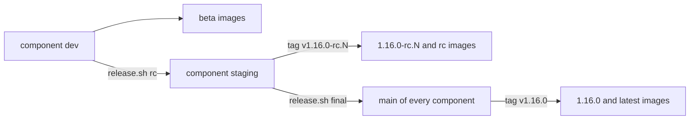

# Ramas y versiones

Los componentes de TypeType se desarrollan de forma independiente y después los
ensambla la pila central. Entender la diferencia entre una rama de código, una imagen
de componente y un despliegue en ejecución evita la mayor parte de las confusiones de
versión.

## Una sola versión para todo el stack {#one-version-for-the-whole-stack}

Desde TypeType 1.15.0, cada componente sale con la versión de TypeType. TypeType
1.16.0 es web 1.16.0, servidor 1.16.0, token 1.16.0 y downloader 1.16.0, aunque un
componente no haya cambiado, así que un solo número dice qué ejecuta una instancia.

## Líneas de desarrollo, staging y estable {#development-staging-and-stable-lines}

| Línea | Rama | Etiquetas de imagen | Función |
| --- | --- | --- | --- |
| Desarrollo | `dev` | `typetype-beta:latest`, `typetype-beta:1.15.0-beta.N`, ... | Integración y despliegue beta, puede romperse |
| Staging | `staging` | `typetype:1.16.0-rc.N`, `typetype:rc`, ... | Versiones candidatas de la próxima versión |
| Estable | `main` | `typetype:1.16.0`, `typetype:latest`, ... | Stack autoalojado publicado |

Las mismas etiquetas existen para `typetype-server`, `typetype-token` y
`typetype-downloader`, todas bajo `ghcr.io/typetype-video/`. Una imagen beta lleva el
número de la última versión y su número de compilación: `1.15.0-beta.N` es una
compilación hecha después de la 1.15.0.

Las pull requests de código apuntan a `dev`. El repositorio central de TypeType usa
`main` por defecto porque también es el punto de entrada de la instalación y de las
versiones.

## Cómo se publica una versión {#how-a-release-is-made}



1. El trabajo llega a `dev`. Cada push construye las imágenes beta.
2. Cuando un componente está listo, `scripts/release.sh rc 1.16.0 web` en el
   repositorio central lleva la rama `staging` de ese componente a `dev` y pone la
   siguiente etiqueta `v1.16.0-rc.N`. La etiqueta construye la imagen `1.16.0-rc.N` y
   mueve `rc`. Cada componente tiene sus propias versiones candidatas, tantas como
   necesite.
3. Cuando las versiones candidatas funcionan juntas, `scripts/release.sh final 1.16.0`
   lleva `main` a `staging` y pone la etiqueta `v1.16.0` en todos los componentes a la
   vez. Las etiquetas construyen las imágenes `1.16.0` y mueven `latest`.
4. El repositorio central publica las notas de la versión y su propia etiqueta
   `v1.16.0`.

Las imágenes solo salen de estas etiquetas: un push a `main` no construye nada, y la
versión se lee de la etiqueta, no de un archivo. `scripts/release.sh status 1.16.0`
muestra en qué punto está cada componente.

`latest` solo se mueve el día de una versión, así que un pull siempre trae imágenes
publicadas juntas. Aun así es una etiqueta móvil: fija una versión con
`TYPETYPE_VERSION`, como se explica en
[Mantenimiento](/es/self-hosting/maintenance#pin-a-release), o anota los digests de las
imágenes antes de actualizar, como se explica en
[Revertir una actualización](/es/self-hosting/rollback).

## Submódulos centrales {#central-submodules}

El repositorio central también contiene submódulos de Git para Frontend, Server,
Player, Token, Downloader y Docs. Un commit central fija una revisión exacta del
código de cada componente, mientras que `.gitmodules` indica `dev` como la rama que se
sigue durante el desarrollo activo.

El árbol de submódulos es útil para coordinar y revisar el código. La procedencia en
ejecución debe comprobarse aun así con el resumen real del contenedor o con los puntos
de acceso `/api/version/*`, porque los valores por defecto de Compose seleccionan
imágenes de canal en lugar de construir todos los submódulos localmente.

## Comprobar qué se está ejecutando {#check-what-is-running}

Desde fuera de la instancia:

```sh
curl -fsS https://watch.example.com/api/version
curl -fsS https://watch.example.com/api/version/web
curl -fsS https://watch.example.com/api/version/server
curl -fsS https://watch.example.com/api/version/token
curl -fsS https://watch.example.com/api/version/downloader
```

Desde el host:

```sh
docker compose images
docker image inspect "$(docker compose images -q typetype-server)" \
  --format '{{index .RepoDigests 0}}'
```

Las respuestas HTTP identifican las revisiones del código y las fechas de compilación.
La inspección de Docker identifica el resumen inmutable de la imagen. Conserva ambos
cuando documentes o informes de un comportamiento específico de una versión.

## Despliegues main y beta {#main-and-beta-deployments}

Las pilas estable y beta pueden ejecutarse una junto a otra con nombres de proyecto de
Compose y puertos separados. No hay que suponer que ejecutan las mismas revisiones de
los componentes: la beta avanza cada vez que se acepta la imagen `dev` de un
componente, mientras que la estable avanza mediante el proceso de versiones.

Consulta [Beta y main](/es/self-hosting/beta-and-main) para ver los comandos y las
pautas de aislamiento.

## Referencias {#source-references}

- [Configuración central de submódulos](https://github.com/TypeType-Video/TypeType/blob/main/.gitmodules)
- [Flujo de trabajo central de imágenes de componentes](https://github.com/TypeType-Video/TypeType/blob/main/.github/workflows/component-image.yml)
- [Selección de imágenes en el Compose estable](https://github.com/TypeType-Video/TypeType/blob/main/docker-compose.yml)
- [Selección de imágenes en el Compose beta](https://github.com/TypeType-Video/TypeType/blob/main/docker-compose.dev.yml)
