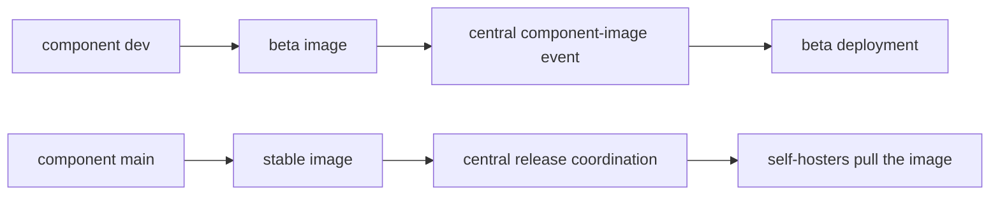

# Ramas y versiones

Los componentes de TypeType se desarrollan de forma independiente y después los
ensambla la pila central. Entender la diferencia entre una rama de código, una imagen
de componente y un despliegue en ejecución evita la mayor parte de las confusiones de
versión.

## Líneas de desarrollo y estable {#development-and-stable-lines}

| Línea | Rama | Patrón de las imágenes de contenedor | Propósito |
| --- | --- | --- | --- |
| Desarrollo | `dev` | `typetype-beta`, `typetype-server-beta`, `typetype-token-beta`, `typetype-downloader-beta` | Integración y despliegue beta |
| Estable | `main` | `typetype`, `typetype-server`, `typetype-token`, `typetype-downloader` | Pila autoalojada publicada |

Todos los nombres de imagen anteriores están bajo `ghcr.io/typetype-video/` y usan la
etiqueta `:latest`, salvo que un valor alternativo seleccione otra etiqueta o un
resumen.

La mayoría de los repositorios de componentes usan `dev` como rama por defecto. Las
pull requests de código apuntan a `dev`; una promoción de versión lleva el trabajo
seleccionado a `main`. El repositorio central TypeType usa `main` por defecto porque
también es el punto de entrada de la instalación y de las versiones.

`latest` es una etiqueta de contenedor móvil. Identifica la imagen más reciente de ese
canal, no una versión inmutable. Anota los resúmenes de las imágenes antes de
actualizar y úsalos para revertir, como se describe en
[Revertir una actualización](/es/self-hosting/rollback).

## Flujo de las imágenes de los componentes {#component-image-flow}



Los flujos de trabajo de los componentes construyen y publican sus propias imágenes.
Después notifican al repositorio central con el nombre del componente, el canal, el
resumen de la imagen, la revisión del código y la versión de compilación. El flujo de
trabajo central despliega la beta automáticamente. Las notificaciones estables se
registran; un despliegue estable, público o autoalojado, se actualiza mediante su
propio proceso de versión o de instalación.

## Submódulos centrales {#central-submodules}

El repositorio central también contiene submódulos de Git para Frontend, Server,
Player, Token, Downloader y Docs. Un commit central fija una revisión exacta del
código de cada componente, mientras que `.gitmodules` indica `dev` como la rama que se
sigue durante el desarrollo activo.

El árbol de submódulos es útil para coordinar y revisar el código. La procedencia en
ejecución debe comprobarse aun así con el resumen real del contenedor o con los puntos
de acceso `/api/version/*`, porque los valores por defecto de Compose seleccionan
imágenes de canal en lugar de construir todos los submódulos localmente.

## Comprobar qué se está ejecutando {#check-what-is-running}

Desde fuera de la instancia:

```sh
curl -fsS https://watch.example.com/api/version
curl -fsS https://watch.example.com/api/version/web
curl -fsS https://watch.example.com/api/version/server
curl -fsS https://watch.example.com/api/version/token
curl -fsS https://watch.example.com/api/version/downloader
```

Desde el host:

```sh
docker compose images
docker image inspect "$(docker compose images -q typetype-server)" \
  --format '{{index .RepoDigests 0}}'
```

Las respuestas HTTP identifican las revisiones del código y las fechas de compilación.
La inspección de Docker identifica el resumen inmutable de la imagen. Conserva ambos
cuando documentes o informes de un comportamiento específico de una versión.

## Despliegues main y beta {#main-and-beta-deployments}

Las pilas estable y beta pueden ejecutarse una junto a otra con nombres de proyecto de
Compose y puertos separados. No hay que suponer que ejecutan las mismas revisiones de
los componentes: la beta avanza cada vez que se acepta la imagen `dev` de un
componente, mientras que la estable avanza mediante el proceso de versiones.

Consulta [Beta y main](/es/self-hosting/beta-and-main) para ver los comandos y las
pautas de aislamiento.

## Referencias {#source-references}

- [Configuración central de submódulos](https://github.com/TypeType-Video/TypeType/blob/main/.gitmodules)
- [Flujo de trabajo central de imágenes de componentes](https://github.com/TypeType-Video/TypeType/blob/main/.github/workflows/component-image.yml)
- [Selección de imágenes en el Compose estable](https://github.com/TypeType-Video/TypeType/blob/main/docker-compose.yml)
- [Selección de imágenes en el Compose beta](https://github.com/TypeType-Video/TypeType/blob/main/docker-compose.dev.yml)
