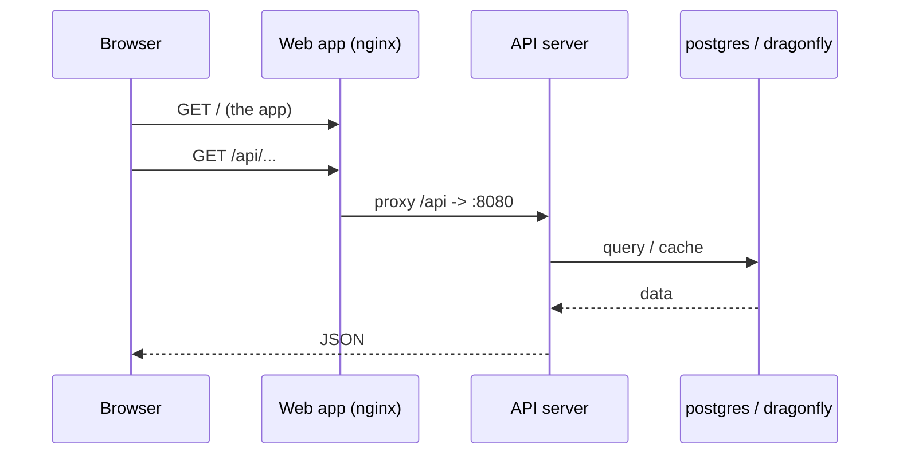
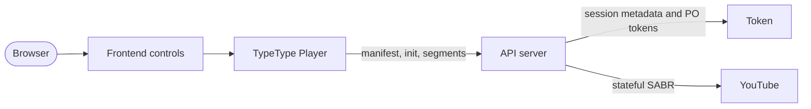
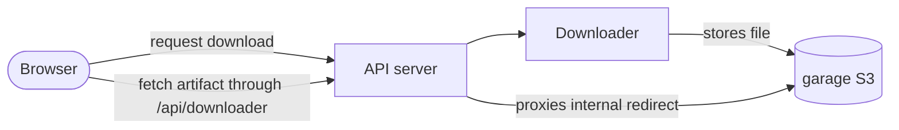

# Arquitectura

Esta página explica cómo se comunican los servicios entre sí y dónde viven tus datos.
No la necesitas para instalar TypeType, pero hace mucho más fácil operar y depurar la
pila.

## Red {#networking}

Compose coloca todos los servicios en una red privada y da a cada uno un nombre DNS
igual a su nombre de servicio (`typetype-server`, `postgres`, `garage`, ...). Los
servicios se alcanzan por esos nombres, nunca por los puertos del host.

Solo unos pocos puertos se **publican** en el host. Los puertos internos de
diagnóstico se enlazan a la interfaz de bucle local por defecto:

| Publicado | Servicio | Quién lo necesita |
| --- | --- | --- |
| `HOST_PORT_WEB` (8082) | aplicación web | tus usuarios (pon aquí el proxy inverso) |
| `HOST_BIND_SERVER:HOST_PORT_SERVER` (`127.0.0.1:8080`) | servidor API | comprobación de estado y acceso directo a la API desde el host, opcionales |
| `HOST_BIND_TOKEN:HOST_PORT_TOKEN` (`127.0.0.1:8081`) | Token | diagnóstico de estado desde el host, opcional |
| `HOST_BIND_GARAGE_S3:HOST_PORT_GARAGE_S3` (`127.0.0.1:3900`) | almacén de objetos | aprovisionamiento y diagnóstico |

Todo lo demás (`postgres`, `dragonfly`, el descargador) queda interno. No añadas
Token, Downloader, PostgreSQL ni Dragonfly a un proxy inverso público. Consulta
[Límites de seguridad](./security).

## Recorrido de una petición {#request-path}

Una visita normal a una página:

El contenedor web sirve la aplicación estática y redirige todo lo que está bajo
`/api/` al servidor, incluidas las actualizaciones a WebSocket. También redirige las
rutas de reproducción `/sabr/`. Por eso tu proxy inverso externo solo necesita apuntar
al contenedor web.

## Recorrido de la reproducción {#playback-path}

Token es una dependencia interna para los tokens PO de YouTube, la decodificación del
reproductor, los metadatos de sesión SABR y los subtítulos. El inicio de sesión remoto
es opcional, pero el propio servicio Token forma parte de la pila normal. Server es
dueño de la sesión de origen y entrega al navegador rutas de medios propias de
TypeType; el navegador nunca llama a Token directamente.

Consulta [Reproducción y descargas](/es/project/playback) para el flujo a nivel de
código.

## Recorrido de una descarga {#download-path}

El descargador escribe el archivo terminado en Garage. La pila incluida da a
Downloader una URL interna de Garage. Cuando el punto de acceso del artefacto redirige
al host interno `garage`, Server lo obtiene y lo transmite por la pasarela pública
`/api/downloader/...`. Por tanto, el navegador no necesita acceso directo a Garage.

Los despliegues personalizados pueden usar un punto de acceso S3 realmente público,
pero eso es un ajuste del servicio Downloader y no un valor de `.env` obligatorio en
la pila compatible.

## Dónde viven los datos {#where-data-lives}

El estado se guarda en volúmenes de Docker con nombre, así que `docker compose down`
(sin `-v`) lo conserva todo:

| Volumen | Contenido |
| --- | --- |
| `postgres_data` | cuentas, historial, listas de reproducción, ajustes |
| `garage_meta`, `garage_data` | el almacén de objetos (descargas) |
| `typetype_secrets` | los secretos generados automáticamente |

Haz copias de seguridad de ellos para conservar un despliegue. Consulta
[Mantenimiento](./maintenance#backups).

## Secretos {#secrets}

El contenedor de inicialización `typetype-secrets` genera dos secretos en el volumen
`typetype_secrets` en el primer arranque. Server y Token los leen de ahí. Los valores
que pones en `.env` tienen prioridad, y el texto de marcador (`SET_ME_...`) se ignora,
así que dejar los marcadores tal cual es seguro. Consulta
[Configuración](./configuration#secrets-handled-automatically).

Garage usa un `GARAGE_RPC_SECRET` aparte, leído de `.env`. El instalador lo genera;
una instalación sin scripts debe generarlo antes de que arranque Garage. Consulta
[Instalación manual](./docker-compose#create-your-configuration).
