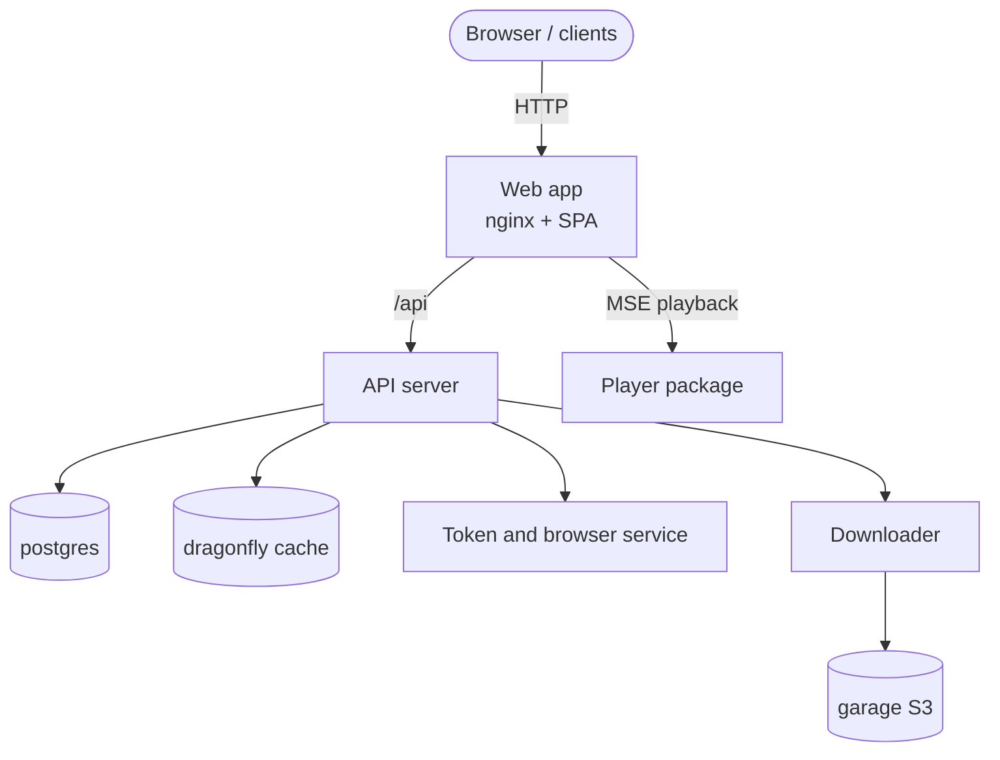

# Introducción

TypeType no es una sola aplicación, es un **ecosistema autoalojable**. Un despliegue es
un conjunto de servicios que cooperan: una aplicación web, un servidor API, un
servicio de tokens y navegador, un descargador y los almacenes de datos de los que
dependen. Juntos te permiten ejecutar tu propia plataforma de vídeo de principio a
fin.

Esta guía cubre tanto el instalador compatible como una instalación manual con Docker
Compose. El instalador crea el `.env`, genera los secretos, elige puertos libres y
aprovisiona el almacén de objetos. La vía manual documenta el mismo despliegue con
comandos sencillos, para que puedas inspeccionar y controlar cada paso.

## Los componentes {#the-components}

| Componente | Repositorio / imagen | Función |
| --- | --- | --- |
| Aplicación web | `ghcr.io/typetype-video/typetype` | La interfaz, más un nginx que redirige `/api` al servidor |
| Servidor API | `ghcr.io/typetype-video/typetype-server` | Cuentas, extracción, la API REST, el núcleo del ecosistema |
| Descargador | `ghcr.io/typetype-video/typetype-downloader` | Prepara las descargas y las guarda en el almacén de objetos |
| Token | `ghcr.io/typetype-video/typetype-token` | Tokens PO de YouTube, decodificación del reproductor, metadatos SABR, subtítulos e inicio de sesión remoto opcional |
| Base de datos | `postgres` | Cuentas, historial, listas de reproducción, ajustes |
| Caché | `dragonfly` | Caché compatible con Redis |
| Almacén de objetos | `garage` | Almacenamiento compatible con S3 para las descargas |

Otros clientes pueden usar el mismo servidor API, así que un único despliegue
autoalojado puede servir a algo más que la aplicación web.

## Cómo encajan {#how-they-fit-together}

Solo la **aplicación web** tiene que ser accesible para tus usuarios. En producción
pones un proxy inverso delante y la sirves por HTTPS, como se describe en
[Proxy inverso y HTTPS](./reverse-proxy).

Token es un servicio interno, pero no es opcional para la reproducción actual de
YouTube. `YOUTUBE_REMOTE_LOGIN_ENABLED` controla únicamente el inicio de sesión
interactivo en YouTube; los tokens PO, el decodificador, los subtítulos y SABR siguen
usando Token cuando el inicio de sesión remoto está desactivado.

Para saber qué repositorio es dueño de qué y conocer la ruta de reproducción en el
navegador, consulta la [visión general del proyecto](/es/project/) y
[Reproducción y descargas](/es/project/playback).

## Qué aspecto tiene {#what-it-looks-like}

Una instancia autoalojada en funcionamiento, reproduciendo un vídeo, buscando, y sus
ajustes:

---

---

---

La reproducción en acción:

## Cómo está organizada esta guía {#how-this-guide-is-organised}

1. [Arquitectura](./architecture): cómo se comunican las piezas y dónde viven los
   datos.
2. [Límites de seguridad](./security): qué es público, interno y respaldado por un
   navegador.
3. [Requisitos](./prerequisites): lo que necesitas antes de empezar.
4. [Inicio rápido](./quick-start): la instalación recomendada con un solo comando.
5. [Instalación manual](./docker-compose): lo mismo a mano, paso a paso.
6. [Configuración](./configuration): cada variable de entorno, explicada.
7. [Importar tus datos](./importing-data): traer suscripciones, listas e historial.
8. [Proxy inverso y HTTPS](./reverse-proxy): exponerlo en tu dominio.
9. [Mantenimiento](./maintenance): actualizaciones, copias de seguridad y registros.
10. [Beta y main](./beta-and-main): ejecutar los canales estable y de vista previa.
11. [Informar de problemas](./reporting-issues): cómo informar de errores.
12. [Solución de problemas](./troubleshooting): problemas habituales y soluciones.

::: tip ¿De dónde salen los archivos?
El `docker-compose.yml`, el `.env.example` y los scripts de la pila que se citan a lo
largo de esta guía están en el repositorio TypeType. La imagen web incluye su
configuración de nginx, y Compose inicializa la configuración por defecto de Garage
en un volumen con nombre. Clona primero el repositorio central (consulta
[Instalación manual](./docker-compose) o [Inicio rápido](./quick-start)).
:::
