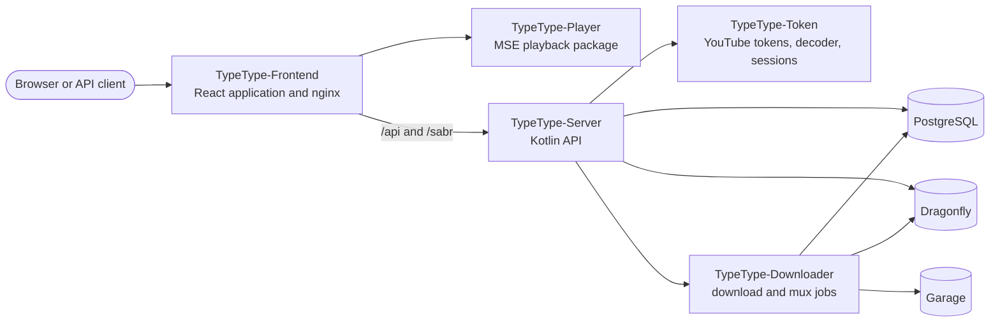

# Vue d'ensemble du projet

TypeType est un ensemble de services et de bibliothèques construits indépendamment et
réunis par la stack de déploiement centrale. Cette section s'adresse aux contributeurs,
aux intégrateurs et aux exploitants qui ont besoin de comprendre quel dépôt possède un
comportement et comment une requête traverse le système.

Si vous voulez seulement installer une instance, commencez par
[l'introduction à l'auto-hébergement](/fr/self-hosting/introduction). Si vous utilisez
une instance existante, voir le [guide utilisateur](/fr/guide/).

## Carte du système {#system-map}

Le navigateur parle au conteneur web. Son nginx intégré sert l'application React et
transmet le trafic d'API, de WebSocket et de lecture à TypeType-Server. Server est la
limite application/API derrière cette passerelle web publique ; Token, Downloader,
PostgreSQL, Dragonfly et Garage sont des services internes.

## Dépôts publics {#public-repositories}

| Dépôt | Possède |
| --- | --- |
| [TypeType](https://github.com/TypeType-Video/TypeType) | Stack Compose, nginx, installateur, mises à jour, retour arrière, coordination des versions et suivi central des issues |
| [TypeType-Frontend](https://github.com/TypeType-Video/TypeType-Frontend) | Routes React, interface, paramètres, parcours de compte et commandes de lecture |
| [TypeType-Server](https://github.com/TypeType-Video/TypeType-Server) | API HTTP, extraction, comptes, données privées des utilisateurs, sessions de lecture et intégrations |
| [TypeType-Token](https://github.com/TypeType-Video/TypeType-Token) | Jetons PO de YouTube, décodage du lecteur, métadonnées SABR, sous-titres et sessions de navigateur pour la connexion distante |
| [TypeType-Downloader](https://github.com/TypeType-Video/TypeType-Downloader) | Tâches de téléchargement persistantes, transfert des médias, multiplexage et artefacts |
| [TypeType-Player](https://github.com/TypeType-Video/TypeType-Player) | Chaîne Media Source Extensions du navigateur utilisée par le frontend |
| [TypeType-RPC](https://github.com/TypeType-Video/TypeType-RPC) | Compagnon de bureau qui affiche votre lecture comme statut Discord Rich Presence |
| [TypeType-Signals](https://github.com/TypeType-Video/TypeType-Signals) | Service de recommandations optionnel : les algorithmes d'accueil que chaque utilisateur choisit et règle |
| [Docs-TypeType](https://github.com/TypeType-Video/Docs-TypeType) | Documentation pour les utilisateurs, les exploitants et le projet |
| [TypeType-Video/.github](https://github.com/TypeType-Video/.github) | Profil de l'organisation et ressources publiques partagées |

Lisez le [Guide des dépôts](./repositories) pour les points d'entrée dans le code, les
vérifications locales, les licences et l'endroit où un changement a sa place.

## Parcours importants {#important-flows}

- [Lecture et téléchargements](./playback) explique SABR, le paquet Player, Token et
  les limites de Downloader.
- [Branches et versions](./releases) explique `dev`, `main`, les images des
  composants, les épinglages de sous-modules et les canaux beta et stable.
- [Signals, le service de recommandations](./signals) explique les algorithmes
  d'accueil optionnels et la place du service à côté de Server.
- [Sources de la communauté](./community) recense les signalements et discussions qui
  ont amélioré à la fois TypeType et cette documentation.

## Sources de vérité {#sources-of-truth}

Utilisez cet ordre quand la documentation et l'implémentation semblent se contredire :

1. Le code et les tests du dépôt qui possède le comportement.
2. Les fichiers Compose et d'installation actuels de la stack centrale, plus la
   configuration nginx intégrée au frontend.
3. Les [issues](https://github.com/TypeType-Video/TypeType/issues) et les [discussions](https://github.com/TypeType-Video/TypeType/discussions) centrales, pour les
   comportements connus, l'expérience des exploitants et les décisions.
4. Ce site, pour le déroulé pris en charge.

Les changements de documentation sont vérifiés par rapport aux trois sources amont
avant d'être présentés comme un comportement stable. Une issue ouverte est l'indice
d'un problème, pas une spécification en soi ; c'est toujours le code du dépôt
propriétaire qui décide de ce que fait la version actuelle.

## Références {#source-references}

- [Stack Compose centrale](https://github.com/TypeType-Video/TypeType/blob/main/docker-compose.yml)
- [Configuration nginx intégrée](https://github.com/TypeType-Video/TypeType-Frontend/blob/dev/nginx.conf)
- [Câblage de l'application Server](https://github.com/TypeType-Video/TypeType-Server/blob/dev/src/main/kotlin/dev/typetype/server/Application.kt)
- [Arborescence du code du Frontend](https://github.com/TypeType-Video/TypeType-Frontend/tree/dev/apps/web/src)
