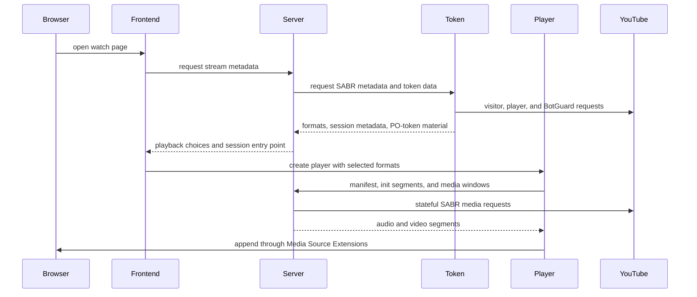
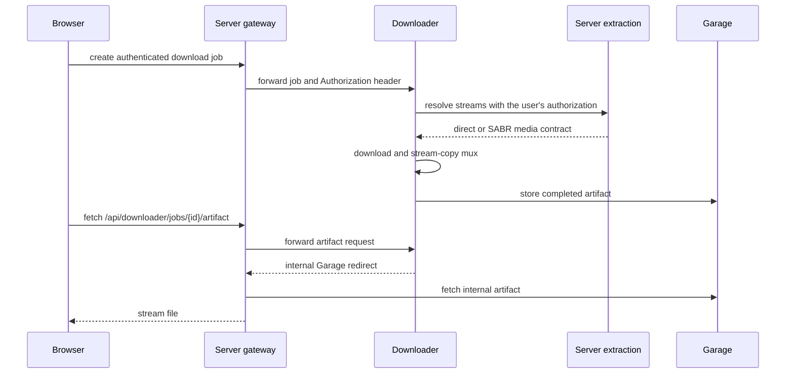

# Lecture et téléchargements

La lecture traverse quatre dépôts : Frontend possède les commandes, Server possède la
session et le contrat public des médias, Token fournit le matériel de session propre
à YouTube, et Player possède la chaîne MSE du navigateur. Downloader réutilise le
contrat de Server quand un utilisateur demande un fichier hors ligne.

## Chemin de la lecture YouTube



Le navigateur ne reçoit pas l'URL SABR amont et ne parle pas à Token. Server garde la
session amont avec état, le choix des formats, la position de lecture, les segments en
cache et la génération de reprise. Player ne demande que des chemins de manifeste et
de médias qui appartiennent à TypeType.

## Responsabilité par couche

### Frontend

Frontend décide de ce que la personne a demandé : qualité, codec, piste audio,
sous-titres, mode audio seul, position, lecture automatique et disposition du lecteur.
Il crée et détruit le moteur de Player et convertit les événements du moteur en état
visible.

### Server

Server expose le contrat de session de lecture sous `/sabr/playback/...`. Il choisit
les formats, crée un jeton de session isolé, précharge les données d'initialisation et
de médias, suit la position de lecture, gère les déplacements et les générations, et
évince les sessions inactives.

Pour le contenu en direct, Server et Player suivent une fenêtre de lecture glissante
plutôt qu'une liste fixe de segments. Un changement de qualité ou de piste audio crée
un état de lecture de remplacement à la position demandée. Ce chemin de remplacement
existe, mais [l'issue #163](https://github.com/TypeType-Video/TypeType/issues/163) suit un échec actuel où la lecture en direct se
fige après un changement de qualité ou de codec.

### Token

Token crée le matériel côté YouTube nécessaire avant que Server puisse construire une
session : données de visiteur, jetons PO, décodage de l'URL du lecteur, métadonnées
des formats adaptatifs et URL de diffusion SABR. Sa réponse `/youtube/sabr/session`
est interne et est convertie en modèles de Server avant que quoi que ce soit n'arrive
au navigateur.

Token est nécessaire à la lecture YouTube actuelle même quand la connexion distante à
YouTube est désactivée. Le réglage optionnel ne commande que le parcours de connexion
interactive, pas le service de jetons et de décodage lui-même.

### Player

`@typetype/mse` charge le manifeste TypeType, les données d'initialisation et les
fenêtres de segments. Il possède les opérations sur MediaSource et SourceBuffer,
l'annulation des requêtes, les limites de tampon avant et arrière, la planification
des segments, les générations de déplacement, les changements de qualité, le suivi du
bord du direct et la reprise après des requêtes périmées ou interrompues.

Le paquet ne contient volontairement ni commandes ni état d'application. Cette limite
permet de tester le comportement de lecture sans l'interface React.

## Autres services de médias

Server enveloppe aussi PipePipeExtractor pour les services pris en charge autres que
YouTube. Selon la réponse extraite, Frontend peut utiliser un média direct, DASH, HLS
ou un proxy TypeType. L'extraction propre à chaque fournisseur reste dans Server ; le
contrat de session SABR TypeType de Player est spécifiquement la chaîne du navigateur
pour la lecture TypeType avec état.

## Chemin d'un téléchargement



La route publique est `/api/downloader/...` ; le service Downloader lui-même reste
interne. Sa tâche garde l'en-tête `Authorization` de l'utilisateur, pour que sa
requête d'extraction ultérieure ait le même accès que la requête d'origine du
navigateur.

Dans la stack fournie, Downloader crée une URL Garage interne. Server reconnaît l'hôte
`garage` et relaie l'artefact au lieu d'envoyer ce nom d'hôte privé au navigateur. Un
déploiement normal n'a donc pas besoin d'exposer Garage ni de définir un point d'accès
S3 tourné vers le navigateur.

## Diagnostiquer une version déployée

Le nginx intégré expose la révision de chaque image d'application :

```sh
curl -fsS https://watch.example.com/api/version
curl -fsS https://watch.example.com/api/version/web
curl -fsS https://watch.example.com/api/version/server
curl -fsS https://watch.example.com/api/version/token
curl -fsS https://watch.example.com/api/version/downloader
```

Joignez ces cinq réponses quand un signalement de lecture ou de téléchargement peut
dépendre d'un changement récent d'un composant. Dites aussi si l'instance suit
[main ou beta](/fr/self-hosting/beta-and-main).

## Signalements qui ont nourri cette page

La séparation actuelle entre la lecture, Token et les limites des conteneurs a été
clarifiée par [l'étude du déploiement de Token par hugoghx](https://github.com/TypeType-Video/TypeType/discussions/156). Des signalements
sur les directs comme [l'issue #145](https://github.com/TypeType-Video/TypeType/issues/145) et [l'issue #163](https://github.com/TypeType-Video/TypeType/issues/163) ont aussi aidé
à identifier les notions de session en direct et de changement de qualité qui doivent
être explicites ici. Voir [Sources de la communauté](./community) pour l'ensemble des
remerciements.

## Références

- [Routes SABR de Server](https://github.com/TypeType-Video/TypeType-Server/blob/dev/src/main/kotlin/dev/typetype/server/routes/SabrRoutes.kt)
- [Stockage des sessions de Server](https://github.com/TypeType-Video/TypeType-Server/blob/dev/src/main/kotlin/dev/typetype/server/services/SabrSessionStore.kt)
- [Client SABR de Server vers Token](https://github.com/TypeType-Video/TypeType-Server/blob/dev/src/main/kotlin/dev/typetype/server/services/TypetypeTokenYoutubeSessionClient.kt)
- [Implémentation de la session SABR de Token](https://github.com/TypeType-Video/TypeType-Token/blob/dev/src/youtube-sabr-session.ts)
- [Code de Player](https://github.com/TypeType-Video/TypeType-Player/tree/dev/src)
- [Passerelle Downloader de Server](https://github.com/TypeType-Video/TypeType-Server/blob/dev/src/main/kotlin/dev/typetype/server/routes/DownloaderGatewayRoutes.kt)
- [Chaîne de traitement de Downloader](https://github.com/TypeType-Video/TypeType-Downloader/tree/dev/internal/pipeline)
