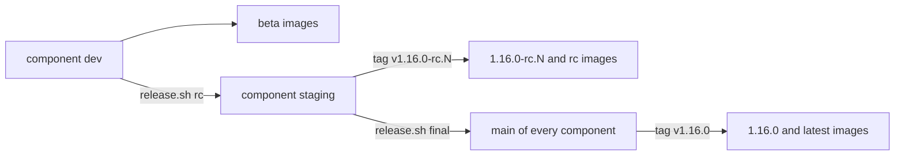

# Branches et versions

Les composants de TypeType sont développés indépendamment, puis assemblés par la stack
centrale. Bien distinguer une branche de code, une image de composant et un
déploiement en cours d'exécution évite l'essentiel des confusions de version.

## Une seule version pour toute la stack {#one-version-for-the-whole-stack}

Depuis TypeType 1.15.0, chaque composant sort avec la version de TypeType. TypeType
1.16.0, c'est le web 1.16.0, le serveur 1.16.0, le token 1.16.0 et le downloader
1.16.0, même quand un composant n'a pas changé : un seul numéro dit ce que fait tourner
une instance.

## Lignes de développement, staging et stable {#development-staging-and-stable-lines}

| Ligne | Branche | Étiquettes d'images | Rôle |
| --- | --- | --- | --- |
| Développement | `dev` | `typetype-beta:latest`, `typetype-beta:1.15.0-beta.N`, ... | Intégration et déploiement beta, peut casser |
| Staging | `staging` | `typetype:1.16.0-rc.N`, `typetype:rc`, ... | Versions candidates de la prochaine version |
| Stable | `main` | `typetype:1.16.0`, `typetype:latest`, ... | Stack auto-hébergée publiée |

Les mêmes étiquettes existent pour `typetype-server`, `typetype-token` et
`typetype-downloader`, toutes sous `ghcr.io/typetype-video/`. Une image beta porte le
numéro de la dernière version et son numéro de construction : `1.15.0-beta.N` est une
construction faite après la 1.15.0.

Les pull requests de code visent `dev`. Le dépôt central TypeType utilise `main` par
défaut, parce qu'il est aussi le point d'entrée de l'installation et des versions.

## Comment une version est publiée {#how-a-release-is-made}



1. Le travail arrive sur `dev`. Chaque push construit les images beta.
2. Quand un composant est prêt, `scripts/release.sh rc 1.16.0 web` dans le dépôt
   central place la branche `staging` de ce composant sur `dev` et pose l'étiquette
   `v1.16.0-rc.N` suivante. L'étiquette construit l'image `1.16.0-rc.N` et déplace
   `rc`. Chaque composant a ses propres versions candidates, autant qu'il en faut.
3. Quand les versions candidates fonctionnent ensemble, `scripts/release.sh final
   1.16.0` place `main` sur `staging` et pose l'étiquette `v1.16.0` dans tous les
   composants en même temps. Les étiquettes construisent les images `1.16.0` et
   déplacent `latest`.
4. Le dépôt central publie les notes de version et sa propre étiquette `v1.16.0`.

Les images ne viennent que de ces étiquettes : un push sur `main` ne construit rien, et
la version est lue dans l'étiquette, pas dans un fichier. `scripts/release.sh status
1.16.0` montre où en est chaque composant.

`latest` ne bouge que le jour d'une version : un pull donne donc toujours des images
publiées ensemble. C'est quand même une étiquette mobile : épinglez une version avec
`TYPETYPE_VERSION`, comme décrit dans
[Maintenance](/fr/self-hosting/maintenance#pin-a-release), ou notez les empreintes des
images avant de mettre à jour, comme décrit dans
[Revenir en arrière après une mise à jour](/fr/self-hosting/rollback).

## Sous-modules centraux {#central-submodules}

Le dépôt central contient aussi des sous-modules Git pour Frontend, Server, Player,
Token, Downloader et Docs. Un commit central épingle une révision exacte du code de
chaque composant, tandis que `.gitmodules` indique `dev` comme branche à suivre pendant
le développement actif.

L'arborescence des sous-modules est utile pour coordonner et relire le code. La
provenance à l'exécution doit quand même être vérifiée sur l'empreinte réelle du
conteneur ou sur les points d'accès `/api/version/*`, parce que les valeurs par défaut
de Compose sélectionnent des images de canal au lieu de construire tous les
sous-modules en local.

## Vérifier ce qui tourne {#check-what-is-running}

Depuis l'extérieur de l'instance :

```sh
curl -fsS https://watch.example.com/api/version
curl -fsS https://watch.example.com/api/version/web
curl -fsS https://watch.example.com/api/version/server
curl -fsS https://watch.example.com/api/version/token
curl -fsS https://watch.example.com/api/version/downloader
```

Depuis l'hôte :

```sh
docker compose images
docker image inspect "$(docker compose images -q typetype-server)" \
  --format '{{index .RepoDigests 0}}'
```

Les réponses HTTP donnent les révisions du code et les dates de construction.
L'inspection Docker donne l'empreinte immuable de l'image. Gardez les deux quand vous
documentez ou signalez un comportement propre à une version.

## Déploiements main et beta {#main-and-beta-deployments}

Les stacks stable et beta peuvent tourner côte à côte avec des noms de projet Compose
et des ports séparés. Il ne faut pas supposer qu'elles font tourner les mêmes
révisions de composants : la beta avance chaque fois que l'image `dev` d'un composant
est acceptée, alors que la stable avance par le processus de version.

Voir [Beta et main](/fr/self-hosting/beta-and-main) pour les commandes et les conseils
d'isolation.

## Références {#source-references}

- [Configuration centrale des sous-modules](https://github.com/TypeType-Video/TypeType/blob/main/.gitmodules)
- [Workflow central des images de composants](https://github.com/TypeType-Video/TypeType/blob/main/.github/workflows/component-image.yml)
- [Sélection des images dans le Compose stable](https://github.com/TypeType-Video/TypeType/blob/main/docker-compose.yml)
- [Sélection des images dans le Compose beta](https://github.com/TypeType-Video/TypeType/blob/main/docker-compose.dev.yml)
