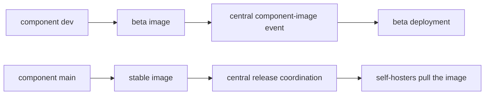

# Branches et versions

Les composants de TypeType sont développés indépendamment, puis assemblés par la stack
centrale. Bien distinguer une branche de code, une image de composant et un
déploiement en cours d'exécution évite l'essentiel des confusions de version.

## Lignes de développement et stable {#development-and-stable-lines}

| Ligne | Branche | Motif des images de conteneurs | Rôle |
| --- | --- | --- | --- |
| Développement | `dev` | `typetype-beta`, `typetype-server-beta`, `typetype-token-beta`, `typetype-downloader-beta` | Intégration et déploiement beta |
| Stable | `main` | `typetype`, `typetype-server`, `typetype-token`, `typetype-downloader` | Stack auto-hébergée publiée |

Tous les noms d'images ci-dessus se trouvent sous `ghcr.io/typetype-video/` et
utilisent l'étiquette `:latest`, sauf si un remplacement sélectionne une autre
étiquette ou une empreinte.

La plupart des dépôts de composants utilisent `dev` comme branche par défaut. Les pull
requests de code visent `dev` ; une promotion de version fait passer le travail retenu
sur `main`. Le dépôt central TypeType utilise `main` par défaut, parce qu'il est aussi
le point d'entrée de l'installation et des versions.

`latest` est une étiquette de conteneur mobile. Elle désigne l'image la plus récente
de ce canal, pas une version immuable. Notez les empreintes des images avant de mettre
à jour et utilisez-les pour revenir en arrière, comme décrit dans
[Revenir en arrière après une mise à jour](/fr/self-hosting/rollback).

## Parcours des images des composants {#component-image-flow}



Les workflows des composants construisent et publient leurs propres images. Ils
préviennent ensuite le dépôt central avec le nom du composant, le canal, l'empreinte de
l'image, la révision du code et la version de construction. Le workflow central
déploie la beta automatiquement. Les notifications stables sont enregistrées ; un
déploiement stable, public ou auto-hébergé, se met à jour par son propre processus de
version ou d'installation.

## Sous-modules centraux {#central-submodules}

Le dépôt central contient aussi des sous-modules Git pour Frontend, Server, Player,
Token, Downloader et Docs. Un commit central épingle une révision exacte du code de
chaque composant, tandis que `.gitmodules` indique `dev` comme branche à suivre pendant
le développement actif.

L'arborescence des sous-modules est utile pour coordonner et relire le code. La
provenance à l'exécution doit quand même être vérifiée sur l'empreinte réelle du
conteneur ou sur les points d'accès `/api/version/*`, parce que les valeurs par défaut
de Compose sélectionnent des images de canal au lieu de construire tous les
sous-modules en local.

## Vérifier ce qui tourne {#check-what-is-running}

Depuis l'extérieur de l'instance :

```sh
curl -fsS https://watch.example.com/api/version
curl -fsS https://watch.example.com/api/version/web
curl -fsS https://watch.example.com/api/version/server
curl -fsS https://watch.example.com/api/version/token
curl -fsS https://watch.example.com/api/version/downloader
```

Depuis l'hôte :

```sh
docker compose images
docker image inspect "$(docker compose images -q typetype-server)" \
  --format '{{index .RepoDigests 0}}'
```

Les réponses HTTP donnent les révisions du code et les dates de construction.
L'inspection Docker donne l'empreinte immuable de l'image. Gardez les deux quand vous
documentez ou signalez un comportement propre à une version.

## Déploiements main et beta {#main-and-beta-deployments}

Les stacks stable et beta peuvent tourner côte à côte avec des noms de projet Compose
et des ports séparés. Il ne faut pas supposer qu'elles font tourner les mêmes
révisions de composants : la beta avance chaque fois que l'image `dev` d'un composant
est acceptée, alors que la stable avance par le processus de version.

Voir [Beta et main](/fr/self-hosting/beta-and-main) pour les commandes et les conseils
d'isolation.

## Références {#source-references}

- [Configuration centrale des sous-modules](https://github.com/TypeType-Video/TypeType/blob/main/.gitmodules)
- [Workflow central des images de composants](https://github.com/TypeType-Video/TypeType/blob/main/.github/workflows/component-image.yml)
- [Sélection des images dans le Compose stable](https://github.com/TypeType-Video/TypeType/blob/main/docker-compose.yml)
- [Sélection des images dans le Compose beta](https://github.com/TypeType-Video/TypeType/blob/main/docker-compose.dev.yml)
