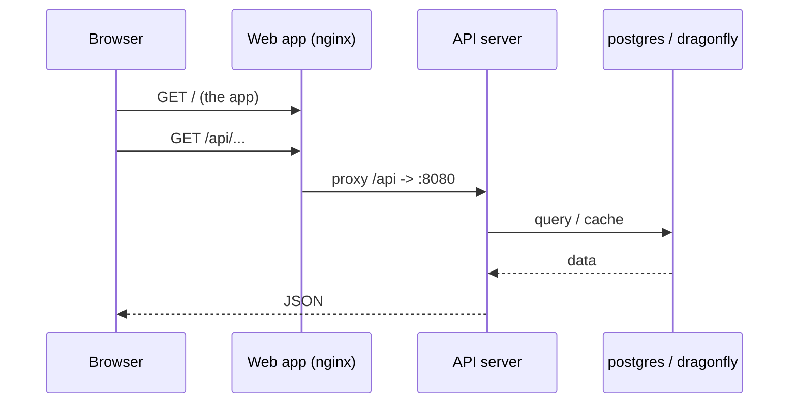
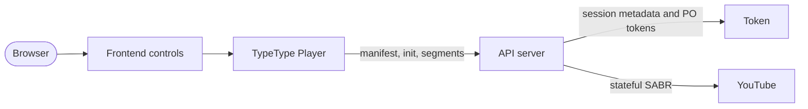
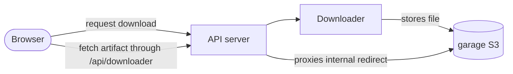

# Architecture

Cette page explique comment les services se parlent et où vivent vos données. Vous
n'en avez pas besoin pour installer TypeType, mais elle rend l'exploitation et le
débogage de la stack bien plus faciles.

## Réseau {#networking}

Compose place tous les services sur un réseau privé et donne à chacun un nom DNS égal
à son nom de service (`typetype-server`, `postgres`, `garage`, ...). Les services se
joignent par ces noms, jamais par les ports de l'hôte.

Seuls quelques ports sont **publiés** sur l'hôte. Les ports de diagnostic internes
sont liés à la boucle locale par défaut :

| Publié | Service | Qui en a besoin |
| --- | --- | --- |
| `HOST_PORT_WEB` (8082) | application web | vos utilisateurs (mettez le proxy inverse ici) |
| `HOST_BIND_SERVER:HOST_PORT_SERVER` (`127.0.0.1:8080`) | serveur API | contrôle de santé et accès direct à l'API depuis l'hôte, optionnels |
| `HOST_BIND_TOKEN:HOST_PORT_TOKEN` (`127.0.0.1:8081`) | Token | diagnostic de santé depuis l'hôte, optionnel |
| `HOST_BIND_GARAGE_S3:HOST_PORT_GARAGE_S3` (`127.0.0.1:3900`) | stockage objet | provisionnement et diagnostic |

Tout le reste (`postgres`, `dragonfly`, le téléchargeur) reste interne. N'ajoutez pas
Token, Downloader, PostgreSQL ni Dragonfly à un proxy inverse public. Voir
[Limites de sécurité](./security).

## Chemin d'une requête {#request-path}

Un affichage de page normal :

Le conteneur web sert l'application statique et relaie tout ce qui est sous `/api/`
vers le serveur, y compris les passages en WebSocket. Il relaie aussi les chemins de
lecture `/sabr/`. C'est pourquoi votre proxy inverse externe n'a jamais besoin de
pointer ailleurs que sur le conteneur web.

## Chemin de la lecture {#playback-path}

Token est une dépendance interne pour les jetons PO de YouTube, le décodage du
lecteur, les métadonnées de session SABR et les sous-titres. La connexion distante est
optionnelle, mais le service Token lui-même fait partie de la stack normale. Server
possède la session amont et donne au navigateur des chemins de médias qui
appartiennent à TypeType ; le navigateur n'appelle jamais Token directement.

Voir [Lecture et téléchargements](/fr/project/playback) pour le déroulé côté code.

## Chemin d'un téléchargement {#download-path}

Le téléchargeur écrit le fichier terminé dans Garage. La stack fournie donne à
Downloader une URL Garage interne. Quand le point d'accès de l'artefact redirige vers
l'hôte interne `garage`, Server le récupère et le diffuse par la passerelle publique
`/api/downloader/...`. Le navigateur n'a donc pas besoin d'un accès direct à Garage.

Des déploiements sur mesure peuvent utiliser un point d'accès S3 réellement public,
mais c'est un réglage du service Downloader et non une valeur `.env` requise dans la
stack prise en charge.

## Où vivent les données {#where-data-lives}

L'état est conservé dans des volumes Docker nommés : `docker compose down` (sans
`-v`) garde donc tout :

| Volume | Contenu |
| --- | --- |
| `postgres_data` | comptes, historique, playlists, paramètres |
| `garage_meta`, `garage_data` | le stockage objet (téléchargements) |
| `typetype_secrets` | les secrets générés automatiquement |

Sauvegardez-les pour préserver un déploiement. Voir
[Maintenance](./maintenance#backups).

## Secrets {#secrets}

Le conteneur d'initialisation `typetype-secrets` génère deux secrets dans le volume
`typetype_secrets` au premier démarrage. Server et Token les lisent à cet endroit. Les
valeurs que vous mettez dans `.env` sont prioritaires, et le texte de remplacement
(`SET_ME_...`) est ignoré : laisser ces textes tels quels est donc sans danger. Voir
[Configuration](./configuration#secrets-handled-automatically).

Garage utilise un `GARAGE_RPC_SECRET` distinct, lu dans `.env`. L'installateur le
génère ; une installation sans script doit le générer avant le démarrage de Garage.
Voir [Installation manuelle](./docker-compose#create-your-configuration).
