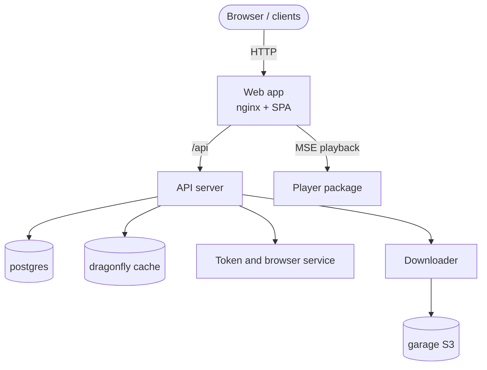

# Introduction

TypeType n'est pas une seule application, c'est un **écosystème auto-hébergeable**. Un
déploiement est un ensemble de services qui coopèrent : une application web, un
serveur API, un service de jetons et de navigateur, un téléchargeur, et les stockages
de données dont ils dépendent. Ensemble, ils vous permettent de faire tourner votre
propre plateforme vidéo de bout en bout.

Ce guide couvre à la fois l'installateur pris en charge et une installation manuelle
avec Docker Compose. L'installateur crée le `.env`, génère les secrets, choisit des
ports libres et provisionne le stockage objet. Le chemin manuel décrit le même
déploiement en commandes simples, pour que vous puissiez inspecter et maîtriser chaque
étape.

## Les composants {#the-components}

| Composant | Dépôt / image | Rôle |
| --- | --- | --- |
| Application web | `ghcr.io/typetype-video/typetype` | L'interface, plus un nginx qui relaie `/api` vers le serveur |
| Serveur API | `ghcr.io/typetype-video/typetype-server` | Comptes, extraction, API REST, le cœur de l'écosystème |
| Téléchargeur | `ghcr.io/typetype-video/typetype-downloader` | Prépare les téléchargements et les range dans le stockage objet |
| Token | `ghcr.io/typetype-video/typetype-token` | Jetons PO de YouTube, décodage du lecteur, métadonnées SABR, sous-titres et connexion distante optionnelle |
| Base de données | `postgres` | Comptes, historique, playlists, paramètres |
| Cache | `dragonfly` | Cache compatible Redis |
| Stockage objet | `garage` | Stockage compatible S3 pour les téléchargements |

D'autres clients peuvent utiliser le même serveur API : un seul déploiement
auto-hébergé peut donc servir plus que l'application web.

## Comment ils s'assemblent {#how-they-fit-together}

Seule l'**application web** doit être joignable par vos utilisateurs. En production,
vous placez un proxy inverse devant elle et la servez en HTTPS, comme décrit dans
[Proxy inverse et HTTPS](./reverse-proxy).

Token est un service interne, mais il n'est pas optionnel pour la lecture YouTube
actuelle. `YOUTUBE_REMOTE_LOGIN_ENABLED` ne commande que la connexion interactive à
YouTube ; les jetons PO, le décodeur, les sous-titres et SABR passent toujours par
Token quand la connexion distante est désactivée.

Pour savoir quel dépôt possède quoi et connaître le chemin de lecture dans le
navigateur, voir la [vue d'ensemble du projet](/fr/project/) et
[Lecture et téléchargements](/fr/project/playback).

## À quoi cela ressemble {#what-it-looks-like}

Une instance auto-hébergée une fois lancée, en train de lire une vidéo, de chercher,
et ses paramètres :

---

---

---

La lecture en action :

## Comment ce guide est organisé {#how-this-guide-is-organised}

1. [Architecture](./architecture) : comment les pièces communiquent, et où vivent les
   données.
2. [Limites de sécurité](./security) : ce qui est public, interne, et appuyé sur un
   navigateur.
3. [Prérequis](./prerequisites) : ce qu'il vous faut avant de commencer.
4. [Démarrage rapide](./quick-start) : l'installation recommandée en une commande.
5. [Installation manuelle](./docker-compose) : la même chose à la main, pas à pas.
6. [Configuration](./configuration) : chaque variable d'environnement, expliquée.
7. [Importer vos données](./importing-data) : ramener abonnements, playlists,
   historique.
8. [Proxy inverse et HTTPS](./reverse-proxy) : l'exposer sur votre domaine.
9. [Maintenance](./maintenance) : mises à jour, sauvegardes et journaux.
10. [Beta et main](./beta-and-main) : faire tourner les canaux stable et préversion.
11. [Signaler un problème](./reporting-issues) : comment signaler les bugs.
12. [Dépannage](./troubleshooting) : problèmes courants et solutions.

::: tip D'où viennent les fichiers ?
Le `docker-compose.yml`, le `.env.example` et les scripts de la stack cités tout au
long de ce guide se trouvent dans le dépôt TypeType. L'image web inclut sa
configuration nginx, et Compose initialise la configuration par défaut de Garage dans
un volume nommé. Clonez d'abord le dépôt central (voir
[Installation manuelle](./docker-compose) ou [Démarrage rapide](./quick-start)).
:::
