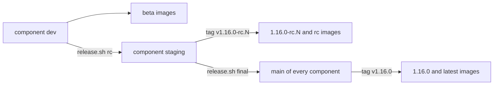

# Branches and releases

TypeType components are developed independently and then assembled by the central
stack. Understanding the distinction between a source branch, a component image,
and a running deployment avoids most version confusion.

## One version for the whole stack

Since TypeType 1.15.0, every component ships with the TypeType version. TypeType
1.16.0 is web 1.16.0, server 1.16.0, token 1.16.0 and downloader 1.16.0, even when a
component did not change, so one number tells what an instance runs.

## Development, staging and stable lines

| Line | Branch | Image tags | Purpose |
| --- | --- | --- | --- |
| Development | `dev` | `typetype-beta:latest`, `typetype-beta:1.15.0-beta.N`, ... | Integration and beta deployment, can break |
| Staging | `staging` | `typetype:1.16.0-rc.N`, `typetype:rc`, ... | Release candidates of the next version |
| Stable | `main` | `typetype:1.16.0`, `typetype:latest`, ... | Released self-hosted stack |

The same tags exist for `typetype-server`, `typetype-token` and `typetype-downloader`,
all under `ghcr.io/typetype-video/`. A beta image carries the last release number and
its build number, so `1.15.0-beta.N` is a build made after 1.15.0.

Code pull requests target `dev`. The central TypeType repository uses `main` as its
default branch because it is also the installation and release entry point.

## How a release is made



1. Work lands on `dev`. Every push builds the beta images.
2. When a component is ready, `scripts/release.sh rc 1.16.0 web` in the central
   repository moves that component's `staging` branch to `dev` and tags the next
   `v1.16.0-rc.N`. The tag builds the `1.16.0-rc.N` image and moves `rc`. Each
   component gets its own release candidates, as many as it needs.
3. When the release candidates work together, `scripts/release.sh final 1.16.0`
   moves `main` to `staging` and tags `v1.16.0` in every component at once. The tags
   build the `1.16.0` images and move `latest`.
4. The central repository publishes the release notes and its own `v1.16.0` tag.

Images come only from these tags: a push to `main` builds nothing, and the version is
read from the tag, not from a file. `scripts/release.sh status 1.16.0` shows where
every component stands.

`latest` only moves on release day, so a pull always gives a set of images released
together. It is still a moving tag: pin a release with `TYPETYPE_VERSION`, as
described in [Maintenance](/self-hosting/maintenance#pin-a-release), or record the
image digests before updating, as described in
[Roll back an update](/self-hosting/rollback).

## Central submodules

The central repository also contains Git submodules for Frontend, Server, Player,
Token, Downloader, and Docs. A central commit pins one exact source revision for each
component, while `.gitmodules` records `dev` as the branch to follow during active
development.

The submodule tree is useful for source coordination and review. Runtime provenance
must still be checked against the actual container digest or the `/api/version/*`
endpoints, because the Compose defaults select channel images rather than building
all submodules locally.

## Check what is running

From outside the instance:

```sh
curl -fsS https://watch.example.com/api/version
curl -fsS https://watch.example.com/api/version/web
curl -fsS https://watch.example.com/api/version/server
curl -fsS https://watch.example.com/api/version/token
curl -fsS https://watch.example.com/api/version/downloader
```

From the host:

```sh
docker compose images
docker image inspect "$(docker compose images -q typetype-server)" \
  --format '{{index .RepoDigests 0}}'
```

The HTTP responses identify source revisions and build times. The Docker inspection
identifies the immutable image digest. Keep both when documenting or reporting a
release-specific behavior.

## Main and beta deployments

The stable and beta stacks can run side by side with separate Compose project names
and ports. They should not be assumed to run identical component revisions: beta
advances whenever a component's `dev` image is accepted, while stable advances through
the release process.

See [Beta and main](/self-hosting/beta-and-main) for commands and isolation guidance.

## Source references

- [Central submodule configuration](https://github.com/TypeType-Video/TypeType/blob/main/.gitmodules)
- [Central component-image workflow](https://github.com/TypeType-Video/TypeType/blob/main/.github/workflows/component-image.yml)
- [Stable Compose image selection](https://github.com/TypeType-Video/TypeType/blob/main/docker-compose.yml)
- [Beta Compose image selection](https://github.com/TypeType-Video/TypeType/blob/main/docker-compose.dev.yml)
