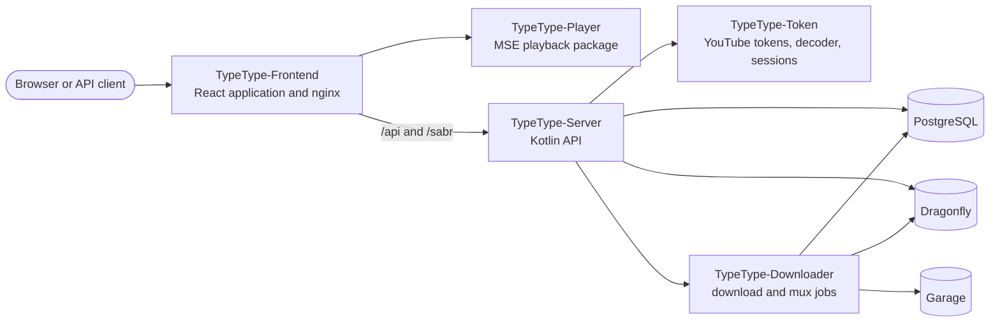

# 项目概览

TypeType 是一组各自独立构建的服务和库，由中心的部署把它们组合在一起。本节面向贡献者、集成者和运营者，帮助他们了解某种行为归哪个仓库负责，以及一个请求如何在系统中流转。

如果你只是想安装一个实例，请从[自托管简介](/zh/self-hosting/introduction)开始。如果你使用的是已有的实例，请看[用户指南](/zh/guide/)。

## 系统图 {#system-map}

浏览器与网页容器通信。它自带的 nginx 提供 React 应用，并把 API、WebSocket 和播放流量转发给 TypeType-Server。Server 是这个公开网页网关背后的应用与 API 边界；Token、Downloader、PostgreSQL、Dragonfly 和 Garage 都是内部服务。

## 公开仓库 {#public-repositories}

| 仓库 | 负责 |
| --- | --- |
| [TypeType](https://github.com/TypeType-Video/TypeType) | Compose 部署、nginx、安装脚本、更新、回滚、版本协调以及中心问题跟踪器 |
| [TypeType-Frontend](https://github.com/TypeType-Video/TypeType-Frontend) | React 路由、界面、设置、账号流程和播放控制 |
| [TypeType-Server](https://github.com/TypeType-Video/TypeType-Server) | HTTP API、提取、账号、用户的私有数据、播放会话和各种集成 |
| [TypeType-Token](https://github.com/TypeType-Video/TypeType-Token) | YouTube PO 令牌、播放器解码、SABR 元数据、字幕，以及远程登录所用的浏览器会话 |
| [TypeType-Downloader](https://github.com/TypeType-Video/TypeType-Downloader) | 持久化的下载任务、媒体传输、封装和成品文件 |
| [TypeType-Player](https://github.com/TypeType-Video/TypeType-Player) | frontend 使用的浏览器 Media Source Extensions 处理流程 |
| [TypeType-RPC](https://github.com/TypeType-Video/TypeType-RPC) | 把你的播放内容显示为 Discord Rich Presence 状态的桌面伴侣程序 |
| [TypeType-Signals](https://github.com/TypeType-Video/TypeType-Signals) | 可选的推荐服务：每位用户自己选择并调整的首页算法 |
| [Docs-TypeType](https://github.com/TypeType-Video/Docs-TypeType) | 面向用户、运营者和项目本身的文档 |
| [TypeType-Video/.github](https://github.com/TypeType-Video/.github) | 组织的主页资料和共享的公开资源 |

源码入口、本地检查、许可证以及某项改动应该放在哪里，见[仓库指南](./repositories)。

## 重要流程 {#important-flows}

- [播放与下载](./playback)说明 SABR、Player 包、Token 以及 Downloader 的边界。
- [分支与版本](./releases)说明 `dev`、`main`、各组件的镜像、子模块的固定版本，以及 beta 和稳定版通道。
- [Signals，推荐服务](./signals)说明可选的首页算法，以及这个服务如何与 Server 配合。
- [社区来源](./community)记录了那些让 TypeType 和这份文档都得到改进的报告与讨论。

## 权威依据 {#sources-of-truth}

当文档与实现看起来不一致时，请按以下顺序判断：

1. 负责该行为的仓库中的源码和测试。
2. 中心部署当前的 Compose 文件和安装脚本，以及 frontend 自带的 nginx 配置。
3. 中心仓库的 [issues](https://github.com/TypeType-Video/TypeType/issues) 和[讨论](https://github.com/TypeType-Video/TypeType/discussions)，用于了解已知行为、运营者的经验和各项决定。
4. 本站，用于了解受支持的流程。

文档的改动在作为稳定行为呈现之前，都会对照上述三个上游来源进行核实。一个未关闭的 issue 说明存在问题，但它本身并不是规范；当前版本实际如何表现，仍由负责的源码决定。

## 参考链接 {#source-references}

- [中心的 Compose 部署](https://github.com/TypeType-Video/TypeType/blob/main/docker-compose.yml)
- [自带的 nginx 配置](https://github.com/TypeType-Video/TypeType-Frontend/blob/dev/nginx.conf)
- [Server 应用的装配代码](https://github.com/TypeType-Video/TypeType-Server/blob/dev/src/main/kotlin/dev/typetype/server/Application.kt)
- [Frontend 的源码树](https://github.com/TypeType-Video/TypeType-Frontend/tree/dev/apps/web/src)
