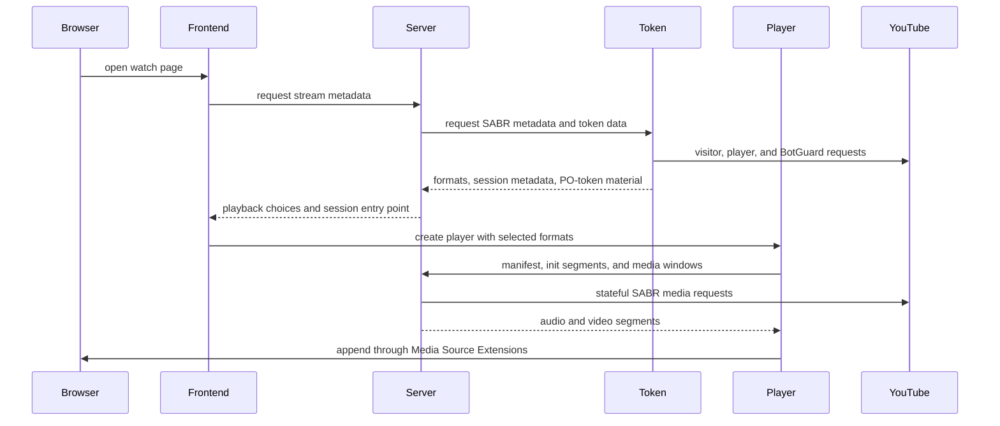
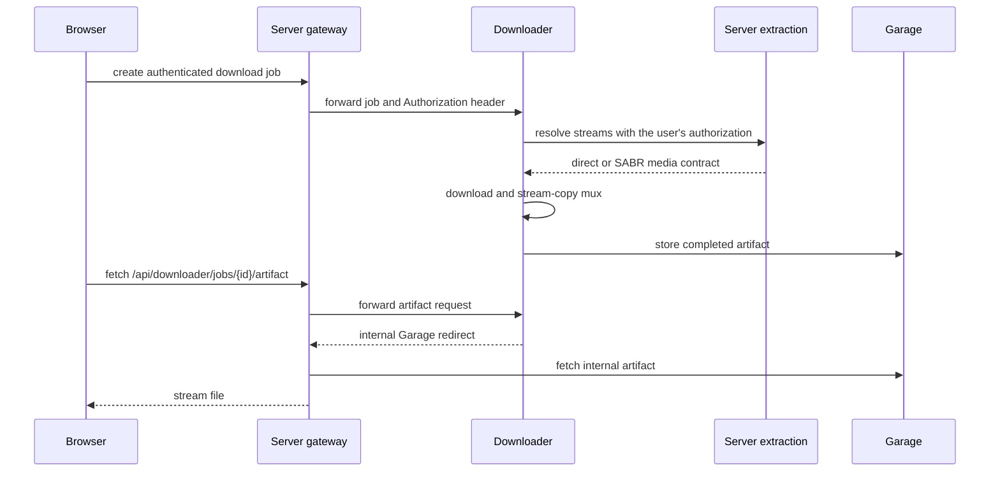

# 播放与下载

播放涉及四个仓库：Frontend 负责控件，Server 负责会话和对外的媒体约定，Token 提供 YouTube 专用的会话材料，Player 负责浏览器中的 MSE 处理流程。当用户请求离线文件时，Downloader 复用 Server 的这套约定。

## YouTube 的播放路径 {#youtube-playback-path}



浏览器既拿不到上游的 SABR 地址，也不与 Token 通信。Server 持有与上游之间的有状态会话、格式选择、播放位置、缓存的分段以及用于恢复的代次。Player 只请求属于 TypeType 的清单路径和媒体路径。

## 各层的职责 {#responsibility-by-layer}

### Frontend {#frontend}

Frontend 决定用户要的是什么：画质、编码、音轨、字幕、仅音频模式、播放位置、自动播放以及播放器的布局。它创建和销毁 Player 引擎，并把引擎的事件转换成可见的状态。

### Server {#server}

Server 在 `/sabr/playback/...` 下提供播放会话的约定。它选择格式、创建隔离的会话令牌、预热初始化数据和媒体数据、跟踪播放位置、处理跳转和代次，并清理空闲的会话。

对于直播内容，Server 和 Player 跟随的是一个滑动的播放窗口，而不是固定的分段列表。切换画质或音轨时，会在所请求的位置创建替换的播放状态。这条替换路径是存在的，但 [issue #163](https://github.com/TypeType-Video/TypeType/issues/163) 跟踪着目前的一个故障：切换画质或编码之后，直播播放会卡住。

### Token {#token}

Token 生成 Server 建立会话之前所需的 YouTube 一侧的材料：访客数据、PO 令牌、播放器地址的解码、自适应格式的元数据，以及 SABR 的流媒体地址。它的 `/youtube/sabr/session` 响应是内部的，在任何内容到达浏览器之前都会先转换成 Server 的模型。

即使关闭了 YouTube 远程登录，目前的 YouTube 播放仍然需要 Token。那个可选的设置只控制交互式的登录流程，并不影响令牌与解码服务本身。

### Player {#player}

`@typetype/mse` 加载 TypeType 的清单、初始化数据和分段窗口。它负责 MediaSource 和 SourceBuffer 的操作、请求的取消、前向与后向缓冲的上限、分段的调度、跳转的代次、画质切换、跟随直播的最新位置，以及从过期或中断的请求中恢复。

这个包有意不包含任何控件或应用状态。有了这条边界，就可以脱离 React 界面来测试播放行为。

## 其他媒体服务 {#other-media-services}

对于 YouTube 之外受支持的服务，Server 还封装了 PipePipeExtractor。根据提取到的响应，Frontend 可以使用直接的媒体地址、DASH、HLS 或 TypeType 的代理。各提供方特有的提取逻辑留在 Server 中；Player 的 TypeType SABR 会话约定，专门用于有状态的 TypeType 播放在浏览器中的处理流程。

## 下载路径 {#download-path}



对外的路由是 `/api/downloader/...`；Downloader 服务本身始终在内部。它的任务会保留用户的 `Authorization` 请求头，这样它之后发出的提取请求就拥有与浏览器最初的请求相同的访问权限。

在自带的部署中，Downloader 生成的是一个内部的 Garage 地址。Server 能识别 `garage` 这个主机，并代为转交文件，而不是把这个私有主机名发给浏览器。因此，正常的部署不需要暴露 Garage，也不需要设置面向浏览器的 S3 端点。

## 诊断已部署的版本 {#diagnosing-a-deployed-version}

自带的 nginx 会给出每个应用镜像的修订号：

```sh
curl -fsS https://watch.example.com/api/version
curl -fsS https://watch.example.com/api/version/web
curl -fsS https://watch.example.com/api/version/server
curl -fsS https://watch.example.com/api/version/token
curl -fsS https://watch.example.com/api/version/downloader
```

如果某个播放或下载方面的报告可能与近期某个组件的改动有关，请附上这五个响应。同时说明实例跟随的是 [main 还是 beta](/zh/self-hosting/beta-and-main)。

## 促成本页的报告 {#reports-that-informed-this-page}

播放、Token 和容器边界之间目前的划分，是经过 [hugoghx 对 Token 部署的研究](https://github.com/TypeType-Video/TypeType/discussions/156)才变得更清楚的。像 [issue #145](https://github.com/TypeType-Video/TypeType/issues/145) 和 [issue #163](https://github.com/TypeType-Video/TypeType/issues/163) 这样的直播相关报告，也帮助我们明确了直播会话和画质切换这两个需要在这里讲清楚的概念。完整的致谢见[社区来源](./community)。

## 参考链接 {#source-references}

- [Server 的 SABR 路由](https://github.com/TypeType-Video/TypeType-Server/blob/dev/src/main/kotlin/dev/typetype/server/routes/SabrRoutes.kt)
- [Server 的会话存储](https://github.com/TypeType-Video/TypeType-Server/blob/dev/src/main/kotlin/dev/typetype/server/services/SabrSessionStore.kt)
- [Server 到 Token 的 SABR 客户端](https://github.com/TypeType-Video/TypeType-Server/blob/dev/src/main/kotlin/dev/typetype/server/services/TypetypeTokenYoutubeSessionClient.kt)
- [Token 的 SABR 会话实现](https://github.com/TypeType-Video/TypeType-Token/blob/dev/src/youtube-sabr-session.ts)
- [Player 的源码](https://github.com/TypeType-Video/TypeType-Player/tree/dev/src)
- [Server 中的 Downloader 网关](https://github.com/TypeType-Video/TypeType-Server/blob/dev/src/main/kotlin/dev/typetype/server/routes/DownloaderGatewayRoutes.kt)
- [Downloader 的处理流程](https://github.com/TypeType-Video/TypeType-Downloader/tree/dev/internal/pipeline)
