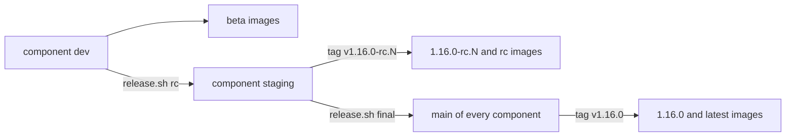

# 分支与版本

TypeType 的各个组件独立开发，然后由中心部署组装在一起。分清源码分支、组件镜像和正在运行的部署这三者，可以避免绝大多数关于版本的混淆。

## 整个部署共用一个版本号 {#one-version-for-the-whole-stack}

从 TypeType 1.15.0 起，每个组件都随 TypeType 的版本号一起发布。TypeType 1.16.0 就是 web 1.16.0、server 1.16.0、token 1.16.0 和 downloader 1.16.0，即使某个组件没有改动也一样，所以一个版本号就能说明一个实例运行的是什么。

## 开发线、staging 线与稳定线 {#development-staging-and-stable-lines}

| 线 | 分支 | 镜像标签 | 用途 |
| --- | --- | --- | --- |
| 开发 | `dev` | `typetype-beta:latest`、`typetype-beta:1.15.0-beta.N`、... | 集成与 beta 部署，可能出问题 |
| Staging | `staging` | `typetype:1.16.0-rc.N`、`typetype:rc`、... | 下一个版本的候选版本 |
| 稳定 | `main` | `typetype:1.16.0`、`typetype:latest`、... | 已发布的自托管部署 |

`typetype-server`、`typetype-token` 和 `typetype-downloader` 也有同样的标签，都位于 `ghcr.io/typetype-video/` 之下。beta 镜像带有上一个正式版本的版本号和它自己的构建号，所以 `1.15.0-beta.N` 是 1.15.0 之后的一次构建。

代码的 pull request 指向 `dev`。中心的 TypeType 仓库以 `main` 作为默认分支，因为它同时也是安装和发布的入口。

## 一个版本是怎样发布的 {#how-a-release-is-made}



1. 工作先进入 `dev`。每次推送都会构建 beta 镜像。
2. 某个组件准备好后，在中心仓库运行 `scripts/release.sh rc 1.16.0 web`，把这个组件的 `staging` 分支移到 `dev`，并打上下一个 `v1.16.0-rc.N` 标签。这个标签会构建 `1.16.0-rc.N` 镜像并移动 `rc`。每个组件都有自己的候选版本，需要多少个就打多少个。与此同时，中心仓库的 `staging` 分支也会移到它的 `dev`，所以与候选版本配套的部署文件始终在 `staging` 上。官方实例跟随 `rc` 镜像，自托管的用户也可以这样做，见[候选版本](/zh/self-hosting/release-candidates)。
3. 候选版本可以一起正常工作后，运行 `scripts/release.sh final 1.16.0`，把每个组件的 `main` 移到 `staging`，并同时打上 `v1.16.0` 标签。这些标签会构建 `1.16.0` 镜像并移动 `latest`。
4. 中心仓库发布版本说明，并打上它自己的 `v1.16.0` 标签。

镜像只来自这些标签：推送到 `main` 不会构建任何东西，版本号从标签读取，而不是从文件读取。`scripts/release.sh status 1.16.0` 会显示每个组件的进度。

`latest` 只在发布当天移动，所以拉取得到的总是一起发布的一组镜像。不过它仍然是一个会移动的标签：可以用 `TYPETYPE_VERSION` 固定一个版本，做法见[维护](/zh/self-hosting/maintenance#pin-a-release)；或者在更新之前记录镜像摘要，做法见[回滚一次更新](/zh/self-hosting/rollback)。

## 中心仓库的子模块 {#central-submodules}

中心仓库还包含 Frontend、Server、Player、Token、Downloader 和 Docs 的 Git 子模块。中心仓库的每个提交都为各个组件固定了一个确切的源码修订号，而 `.gitmodules` 则把 `dev` 记为活跃开发期间跟随的分支。

子模块树对于协调和审查源码很有用。但运行时的来源仍然必须对照实际的容器摘要或 `/api/version/*` 端点来确认，因为 Compose 的默认值选用的是通道镜像，而不是在本地构建所有子模块。

## 检查正在运行的版本 {#check-what-is-running}

从实例外部：

```sh
curl -fsS https://watch.example.com/api/version
curl -fsS https://watch.example.com/api/version/web
curl -fsS https://watch.example.com/api/version/server
curl -fsS https://watch.example.com/api/version/token
curl -fsS https://watch.example.com/api/version/downloader
```

从主机上：

```sh
docker compose images
docker image inspect "$(docker compose images -q typetype-server)" \
  --format '{{index .RepoDigests 0}}'
```

HTTP 响应给出源码修订号和构建时间。Docker 的检查结果给出不可变的镜像摘要。在记录或报告某个与特定版本有关的行为时，请同时保留这两者。

## main 与 beta 的部署 {#main-and-beta-deployments}

稳定版和 beta 的部署可以用不同的 Compose 项目名和端口并行运行。不要假定它们运行的是相同的组件修订号：每当某个组件的 `dev` 镜像被接受时，beta 就会前进，而稳定版则通过发布流程前进。

相关命令和隔离方面的说明见 [Beta 与 main](/zh/self-hosting/beta-and-main)。

## 参考链接 {#source-references}

- [中心仓库的子模块配置](https://github.com/TypeType-Video/TypeType/blob/main/.gitmodules)
- [中心仓库的组件镜像工作流](https://github.com/TypeType-Video/TypeType/blob/main/.github/workflows/component-image.yml)
- [稳定版 Compose 中的镜像选择](https://github.com/TypeType-Video/TypeType/blob/main/docker-compose.yml)
- [Beta 版 Compose 中的镜像选择](https://github.com/TypeType-Video/TypeType/blob/main/docker-compose.dev.yml)
