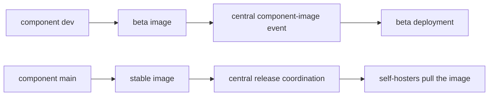

# 分支与版本

TypeType 的各个组件独立开发，然后由中心部署组装在一起。分清源码分支、组件镜像和正在运行的部署这三者，可以避免绝大多数关于版本的混淆。

## 开发线与稳定线 {#development-and-stable-lines}

| 线 | 分支 | 容器镜像的命名 | 用途 |
| --- | --- | --- | --- |
| 开发 | `dev` | `typetype-beta`、`typetype-server-beta`、`typetype-token-beta`、`typetype-downloader-beta` | 集成与 beta 部署 |
| 稳定 | `main` | `typetype`、`typetype-server`、`typetype-token`、`typetype-downloader` | 已发布的自托管部署 |

上面所有的镜像名都位于 `ghcr.io/typetype-video/` 之下，并使用 `:latest` 标签，除非通过替换值选择了其他标签或摘要。

大多数组件仓库以 `dev` 作为默认分支。代码的 pull request 指向 `dev`；发布时再把选定的工作提升到 `main`。中心的 TypeType 仓库以 `main` 作为默认分支，因为它同时也是安装和发布的入口。

`latest` 是一个会移动的容器标签。它指向该通道上最新的镜像，而不是一个不可变的版本。更新之前请记录镜像摘要，并在回滚时使用这些摘要，做法见[回滚一次更新](/zh/self-hosting/rollback)。

## 组件镜像的流转 {#component-image-flow}



各组件的工作流构建并发布各自的镜像。然后它们把组件名称、通道、镜像摘要、源码修订号和构建版本通知给中心仓库。中心的工作流会自动部署 beta。稳定版的通知只做记录；无论是公开的还是自托管的稳定部署，都通过各自的发布或安装流程来更新。

## 中心仓库的子模块 {#central-submodules}

中心仓库还包含 Frontend、Server、Player、Token、Downloader 和 Docs 的 Git 子模块。中心仓库的每个提交都为各个组件固定了一个确切的源码修订号，而 `.gitmodules` 则把 `dev` 记为活跃开发期间跟随的分支。

子模块树对于协调和审查源码很有用。但运行时的来源仍然必须对照实际的容器摘要或 `/api/version/*` 端点来确认，因为 Compose 的默认值选用的是通道镜像，而不是在本地构建所有子模块。

## 检查正在运行的版本 {#check-what-is-running}

从实例外部：

```sh
curl -fsS https://watch.example.com/api/version
curl -fsS https://watch.example.com/api/version/web
curl -fsS https://watch.example.com/api/version/server
curl -fsS https://watch.example.com/api/version/token
curl -fsS https://watch.example.com/api/version/downloader
```

从主机上：

```sh
docker compose images
docker image inspect "$(docker compose images -q typetype-server)" \
  --format '{{index .RepoDigests 0}}'
```

HTTP 响应给出源码修订号和构建时间。Docker 的检查结果给出不可变的镜像摘要。在记录或报告某个与特定版本有关的行为时，请同时保留这两者。

## main 与 beta 的部署 {#main-and-beta-deployments}

稳定版和 beta 的部署可以用不同的 Compose 项目名和端口并行运行。不要假定它们运行的是相同的组件修订号：每当某个组件的 `dev` 镜像被接受时，beta 就会前进，而稳定版则通过发布流程前进。

相关命令和隔离方面的说明见 [Beta 与 main](/zh/self-hosting/beta-and-main)。

## 参考链接 {#source-references}

- [中心仓库的子模块配置](https://github.com/TypeType-Video/TypeType/blob/main/.gitmodules)
- [中心仓库的组件镜像工作流](https://github.com/TypeType-Video/TypeType/blob/main/.github/workflows/component-image.yml)
- [稳定版 Compose 中的镜像选择](https://github.com/TypeType-Video/TypeType/blob/main/docker-compose.yml)
- [Beta 版 Compose 中的镜像选择](https://github.com/TypeType-Video/TypeType/blob/main/docker-compose.dev.yml)
