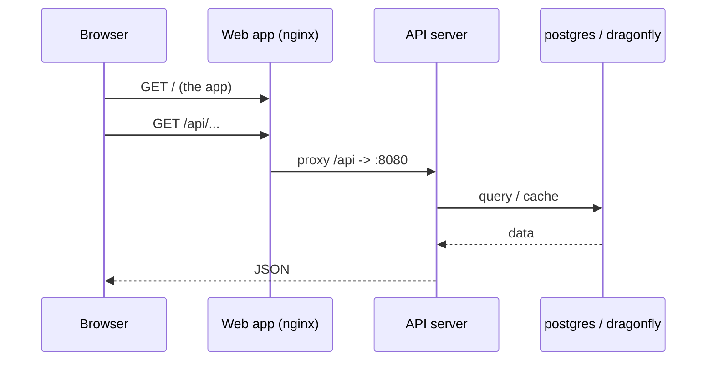
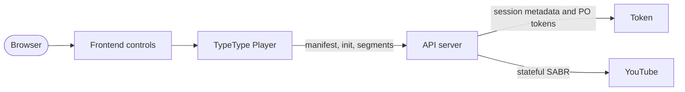
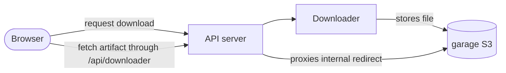

# 架构

本页说明各个服务之间如何通信，以及你的数据存放在哪里。安装 TypeType 并不需要了解这些，但它会让运维和排查问题容易得多。

## 网络 {#networking}

Compose 把所有服务放在同一个私有网络中，并给每个服务一个与其服务名相同的 DNS 名称（`typetype-server`、`postgres`、`garage` 等）。服务之间通过这些名称互相访问，从不经过主机端口。

只有少数端口会**发布**到主机上。内部诊断端口默认绑定到回环地址：

| 发布的端口 | 服务 | 谁需要它 |
| --- | --- | --- |
| `HOST_PORT_WEB`（8082） | 网页应用 | 你的用户（反向代理指向这里） |
| `HOST_BIND_SERVER:HOST_PORT_SERVER`（`127.0.0.1:8080`） | API 服务器 | 可选的主机侧健康检查和直接访问 API |
| `HOST_BIND_TOKEN:HOST_PORT_TOKEN`（`127.0.0.1:8081`） | Token | 可选的主机侧健康诊断 |
| `HOST_BIND_GARAGE_S3:HOST_PORT_GARAGE_S3`（`127.0.0.1:3900`） | 对象存储 | 配置和诊断 |

其余的一切（`postgres`、`dragonfly`、下载器）都保持在内部。不要把 Token、Downloader、PostgreSQL 或 Dragonfly 加到公开的反向代理中。见[安全边界](./security)。

## 请求路径 {#request-path}

一次普通的页面访问：

网页容器提供静态应用，并把 `/api/` 下的所有请求代理给服务器，包括 WebSocket 升级。它还代理 `/sabr/` 播放路径。正因为如此，你外部的反向代理只需要指向网页容器。

## 播放路径 {#playback-path}

Token 是 YouTube PO 令牌、播放器解码、SABR 会话元数据和字幕所需的内部依赖。远程登录功能是可选的，但 Token 服务本身属于正常部署的一部分。Server 拥有上游会话，并向浏览器提供属于 TypeType 的媒体路径；浏览器从不直接调用 Token。

源码层面的流程见[播放与下载](/zh/project/playback)。

## 下载路径 {#download-path}

下载器把完成的文件写入 Garage。自带的部署给 Downloader 的是一个内部的 Garage 地址。当文件的访问端点重定向到内部主机 `garage` 时，Server 会取回文件并通过公开的 `/api/downloader/...` 网关传输。因此浏览器不需要直接访问 Garage。

自定义部署可以使用真正公开的 S3 端点，但那是 Downloader 服务的设置，而不是受支持的部署中必需的 `.env` 值。

## 数据存放在哪里 {#where-data-lives}

状态保存在命名的 Docker 卷中，所以 `docker compose down`（不带 `-v`）会保留一切：

| 卷 | 内容 |
| --- | --- |
| `postgres_data` | 账号、历史记录、播放列表、设置 |
| `garage_meta`、`garage_data` | 对象存储（下载内容） |
| `typetype_secrets` | 自动生成的密钥 |

备份这些卷就能保住整套部署。见[维护](./maintenance#backups)。

## 密钥 {#secrets}

初始化容器 `typetype-secrets` 在首次启动时会在 `typetype_secrets` 卷中生成两个密钥。Server 和 Token 从那里读取它们。你在 `.env` 中设置的值优先，占位文本（`SET_ME_...`）会被忽略，所以保留占位符不动是安全的。见[配置](./configuration#secrets-handled-automatically)。

Garage 使用另一个来自 `.env` 的 `GARAGE_RPC_SECRET`。安装脚本会生成它；不使用脚本的安装必须在 Garage 启动之前生成它。见[手动安装](./docker-compose#create-your-configuration)。
