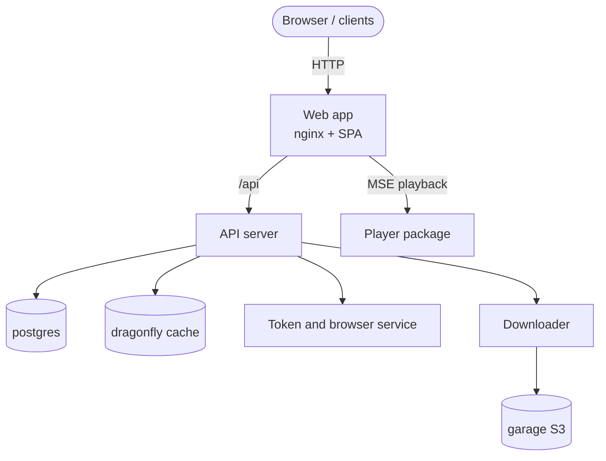

# 简介

TypeType 不是单个应用，而是一个**可以自托管的生态**。一套部署由一组相互配合的服务组成：网页应用、API 服务器、令牌与浏览器服务、下载器，以及它们依赖的数据存储。它们合在一起，让你可以端到端地运行自己的视频平台。

本指南同时介绍受支持的安装脚本和使用 Docker Compose 的手动安装。安装脚本会创建 `.env`、生成密钥、选择空闲端口并配置对象存储。手动方式用普通命令描述同一套部署，方便你检查并控制每一步。

## 各个组件 {#the-components}

| 组件 | 仓库 / 镜像 | 作用 |
| --- | --- | --- |
| 网页应用 | `ghcr.io/typetype-video/typetype` | 界面，外加一个把 `/api` 代理到服务器的 nginx |
| API 服务器 | `ghcr.io/typetype-video/typetype-server` | 账号、提取、REST API，整个生态的核心 |
| 下载器 | `ghcr.io/typetype-video/typetype-downloader` | 准备下载内容并把它们存入对象存储 |
| Token | `ghcr.io/typetype-video/typetype-token` | YouTube PO 令牌、播放器解码、SABR 元数据、字幕，以及可选的远程登录 |
| 数据库 | `postgres` | 账号、历史记录、播放列表、设置 |
| 缓存 | `dragonfly` | 兼容 Redis 的缓存 |
| 对象存储 | `garage` | 兼容 S3 的存储，用于存放下载内容 |

其他客户端也可以使用同一个 API 服务器，所以一套自托管部署能服务的不只是网页应用。

## 它们如何配合 {#how-they-fit-together}

只有**网页应用**需要能被你的用户访问到。在生产环境中，你要在它前面放一个反向代理并通过 HTTPS 提供服务，见[反向代理与 HTTPS](./reverse-proxy)。

Token 是内部服务，但对于目前的 YouTube 播放来说它不是可选的。`YOUTUBE_REMOTE_LOGIN_ENABLED` 只控制交互式的 YouTube 登录功能；即使关闭远程登录，PO 令牌、解码器、字幕和 SABR 仍然要用到 Token。

各仓库分别负责什么，以及浏览器中的播放路径，见[项目概览](/zh/project/)和[播放与下载](/zh/project/playback)。

## 它是什么样子 {#what-it-looks-like}

一个运行中的自托管实例：播放视频、搜索，以及设置页面：

---

---

---

实际播放效果：

## 本指南的结构 {#how-this-guide-is-organised}

1. [架构](./architecture)：各部分如何通信，数据存放在哪里。
2. [安全边界](./security)：哪些是公开的、内部的，哪些依赖浏览器。
3. [前提条件](./prerequisites)：开始之前你需要什么。
4. [快速开始](./quick-start)：推荐的一条命令安装。
5. [手动安装](./docker-compose)：同样的事情，一步一步手动完成。
6. [配置](./configuration)：每个环境变量的说明。
7. [导入你的数据](./importing-data)：带入订阅、播放列表和历史记录。
8. [反向代理与 HTTPS](./reverse-proxy)：在你的域名上对外提供服务。
9. [维护](./maintenance)：更新、备份和日志。
10. [Beta 与 main](./beta-and-main)：运行稳定版和预览版通道。
11. [报告问题](./reporting-issues)：如何报告错误。
12. [故障排查](./troubleshooting)：常见问题及解决办法。

::: tip 这些文件从哪里来？
本指南中提到的 `docker-compose.yml`、`.env.example` 和部署脚本都在 TypeType 仓库中。网页镜像自带 nginx 配置，Compose 则在一个命名卷中初始化 Garage 的默认配置。请先克隆中心仓库（见[手动安装](./docker-compose)或[快速开始](./quick-start)）。
:::
